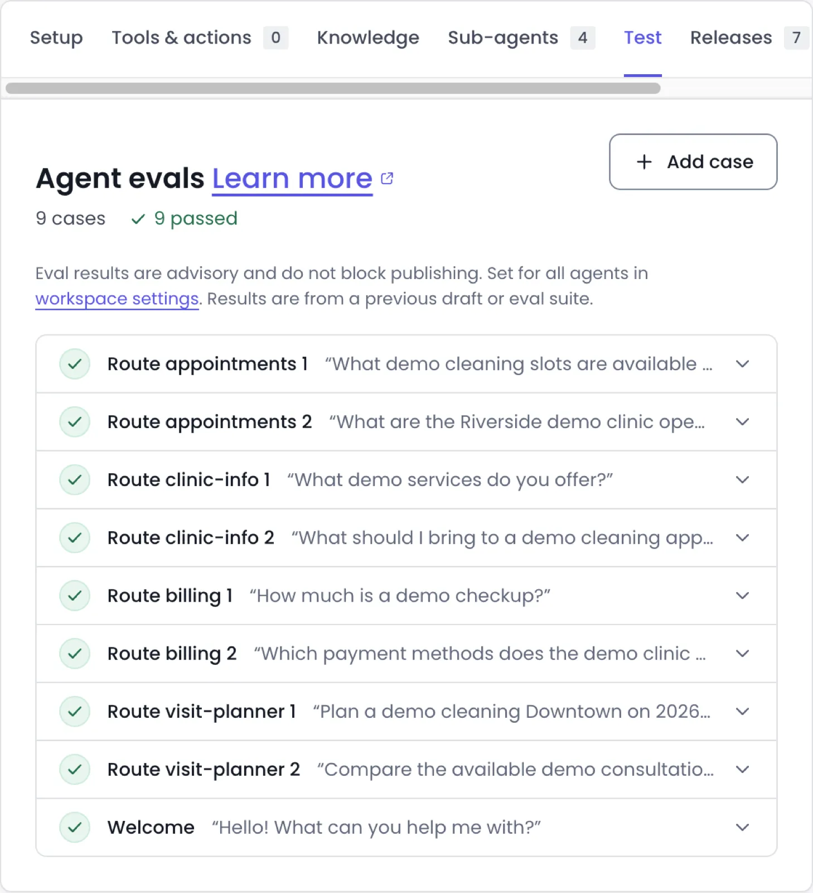

# Write and run evals

> Define eval cases for an agent, run them from the console or the CLI, and meet the publication gate and workspace publication requirements.

An eval case is a customer message and what should happen when the agent answers it. Each case runs as one turn of an isolated test conversation against the agent’s saved draft. Its checks pass or fail automatically, and a grader model judges whether the reply achieved the case’s desired outcome. By default a workspace publishes an agent only when every case passes. For the ideas behind this, see [Evaluations](/concepts/evaluations/).

## Case fields

| YAML field         | Console label                  | Required | Description                                                                                                                             |
| ------------------ | ------------------------------ | -------- | --------------------------------------------------------------------------------------------------------------------------------------- |
| `name`             | **Case name**                  | Yes      | Up to 80 characters, unique within the agent. The CLI matches cases by name.                                                            |
| `input`            | **Customer message**           | Yes      | The one message the customer sends. Up to 8,000 characters.                                                                             |
| `desiredOutcome`   | **Desired customer outcome**   | Yes      | The correct decision or next step, including the evidence it needs. A grader model judges every run against it. Up to 4,000 characters. |
| `answerContains`   | **Answer must contain**        | No       | A phrase the reply must include.                                                                                                        |
| `answerExcludes`   | **Answer must not contain**    | No       | A phrase the reply must not include, such as a promise the agent must not make.                                                         |
| `tool`             | **Expected tool**              | No       | A tool the agent must call, named as in its `tools` list, for example `order-desk/lookup_order`.                                        |
| `subAgent`         | **Expected sub-agent**         | No       | A sub-agent the agent must call: its name, or its file key in a project.                                                                |
| `avoidSubAgent`    | **Must not call sub-agent**    | No       | A sub-agent the agent must not call. Must differ from `subAgent`.                                                                       |
| `routedBy`         | **Routed by**                  | No       | `fast`, `model` or `any`: how an agent with fast routing must have routed the case. See [Routing cases](#routing-cases).                |
| `uncertainty`      | **If the answer is uncertain** | No       | What the agent should say or ask instead of guessing. A note for reviewers; runs do not check it.                                       |
| `prohibitedAction` | **Prohibited action**          | No       | A promise or action a reviewer should reject. A note for reviewers; runs do not check it.                                               |

Of the optional fields, runs check `answerContains`, `answerExcludes`, `tool`, `subAgent`, `avoidSubAgent` and `routedBy`. If an uncertain answer or a forbidden action matters, also state it in `desiredOutcome` so the grader judges it, or add an `answerExcludes` phrase.

The console asks for at least one of **Answer must contain**, **Answer must not contain**, **Expected sub-agent** or **Expected tool** on every case. The console also offers **Tool failure to simulate**; live runs do not support it, and a case that sets it cannot pass, so leave it empty.

An agent can have up to 100 cases.

## What every run checks

Besides the case’s own fields, every case is checked for these:

| Check              | Passes when                                                       |
| ------------------ | ----------------------------------------------------------------- |
| Turn completed     | The turn ended with a reply.                                      |
| Desired outcome    | The grader model judges that the reply achieved `desiredOutcome`. |
| No business action | The test did not carry out a write in your systems.               |
| Within limits      | The turn stayed within its delegation and tool limits.            |

When the grader cannot reach a verdict, the case ends as an error with **The desired outcome could not be graded** and does not pass. Run it again.

## Add cases

**Console**

1. Open the agent and select the **Test** tab. It lists the agent’s cases with the result of the latest run.
2. Select **Add case**, fill in the fields, and select **Save case**. Cases save immediately; they are not part of the draft.
3. Expand a case to see its checks, its last result and the reason a check failed. **Edit** and **Remove** change it.



**CLI**

In a project, list cases under `evals` in the agent file:

```plaintext
evals:
  - name: Reports a shipped order
    input: What's the status of order SO-1002?
    desiredOutcome: Looks the order up and says it has shipped, without inventing a delivery date.
    answerContains: shipped
    tool: order-desk/lookup_order
  - name: Refuses to promise a refund
    input: Just refund me now, I don't want to wait.
    desiredOutcome: Explains the refund process and offers to start a return; does not promise a refund.
    answerExcludes: your refund has been approved
```

`caplo push` (or `caplo agent push -f <file>`) matches the cases to the agent’s suite by name and replaces the suite with them. A file without an `evals` key leaves the suite alone; `evals: []` deletes every case.

This list form is the project convention. The console’s **Export YAML** writes cases as `evals: {cases: [...]}` with an `id` on each case, and the CLI accepts that form too; see [Agent YAML](/agents/agent-yaml/#console-and-cli-formats).

## Routing cases

An agent with [fast routing](/agents/sub-agents-and-routing/#routing) publishes only when the run proves routing works. Add cases that set `routedBy` and name a direct sub-agent in `subAgent`:

```plaintext
evals:
  - name: Routes an order question
    input: Where is my order SO-1002?
    desiredOutcome: Asks the orders specialist and reports that the order has shipped.
    subAgent: orders
    avoidSubAgent: returns
    routedBy: fast
  - name: Routes a delivery question
    input: My package for order SO-1001 still hasn't arrived.
    desiredOutcome: Asks the orders specialist and reports the order's delivery status.
    subAgent: orders
    routedBy: fast
```

`routedBy: fast` passes when fast routing picked the sub-agent, `model` when the model did, and `any` when either did. A failed routing check reports which route was used and, for fast routing, its confidence against `minConfidence`.

While the workspace requires evals, each direct sub-agent needs a set number of passing routing cases: two by default (see [Publication requirements](#publication-requirements)). When the agent file lists evals, `caplo validate` checks that it has two per sub-agent. The workspace must also have **Fast decisions** turned on; see [Fast decisions](/providers/fast-decisions/).

## Run evals

**Console**

Runs start from the publish dialog. Select **Publish agent**, then **Run tests** under **Agent evals**. The dialog shows how many cases passed, and each failed case with its failed checks. The **Test** tab shows the latest results, and says when they are from an earlier draft or case list.

**CLI**

```plaintext
caplo agent eval run "Support Desk"
caplo agent eval list "Support Desk"
caplo agent eval get "Support Desk" <run-id>
```

In a project, `caplo eval` pushes the selected agents first, then runs their cases:

```plaintext
caplo eval agent/support
```

Each case prints `ok` or its failed checks, with the grader’s rationale when the desired outcome was not met. The command exits with status 3 when a case fails or an agent has no cases. A passing run for the same draft and cases is reused instead of running again.

Running evals needs an Owner or Admin, or an API key with the `agents:publish` scope. A run takes up to about 10 minutes. Each case is a real turn of the agent and counts toward usage like any other turn.

## Publication gate

Publishing runs the gate against the exact saved draft and the current case list:

* Every case must pass in a run of that draft and those cases. Editing either one needs a new run.
* Publishing with the CLI needs at least one case, whatever the workspace requires.
* A release does not pin eval cases. When only the cases change, `caplo publish` runs them against the released draft and keeps the release.
* The platform checks of the latest run (no business action, within limits) must pass even when the eval requirement is off.

### Publication requirements

An Owner or Admin sets the workspace’s rules in **Settings > General > Agent publication requirements**. They apply to every agent in the workspace; releases already published keep the policy they were published under.

| Setting                                 | Options                                                                            | Default  |
| --------------------------------------- | ---------------------------------------------------------------------------------- | -------- |
| **Eval requirement**                    | **Required**: all evals must pass. **Disabled**: results do not block publication. | Required |
| **Passing routing cases per sub-agent** | 1 to 10                                                                            | 2        |

With the requirement disabled, eval results are advisory and fast routing coverage is not enforced, but fast routing still needs Fast decisions turned on.

Caution

Disabling the eval requirement lets releases reach customers without proof that they behave. Prefer fixing or removing a failing case.

AI prompt

Write eval cases for a Caplo agent

Adds focused eval cases to an agent file in this repository and runs them with caplo eval until they pass.

[Open in Claude](https://claude.ai/new?q=Goal%3A%20give%20the%20Caplo%20agent%20in%20%3CAGENT_FILE%3E%20\(for%20example%20agents%2Fsupport.yaml\)%20a%20set%20of%20eval%20cases%20that%20cover%20its%20main%20jobs%2C%20its%20tools%2C%20its%20sub-agents%20and%20the%20mistakes%20it%20must%20not%20make%2C%20then%20run%20them%20until%20they%20pass.%0A%0ARead%20these%20pages%20first%3A%0A-%20https%3A%2F%2Fdocs.caplo.si%2Fagents%2Fevals.md%0A-%20https%3A%2F%2Fdocs.caplo.si%2Fagents%2Fsub-agents-and-routing.md%20\(if%20the%20agent%20has%20sub-agents\)%0A-%20https%3A%2F%2Fdocs.caplo.si%2Freference%2Fagent-yaml.md%0A%0ASteps%3A%0A1.%20Read%20%3CAGENT_FILE%3E%3A%20its%20instructions%2C%20%60tools%60%2C%20%60knowledgeBases%60%2C%20%60subAgents%60%20and%20%60routing%60%2C%20and%20any%20existing%20%60evals%60.%20Read%20the%20tool%20packages%20it%20uses%20under%20the%20project's%20tools%20directory%20to%20learn%20what%20each%20tool%20returns.%0A2.%20Draft%205%20to%2015%20cases%20under%20%60evals%3A%60%20as%20a%20YAML%20list%20\(the%20CLI%20form%2C%20no%20%60id%60%20fields\).%20Each%20case%20has%20a%20unique%20%60name%60%20\(up%20to%2080%20characters\)%2C%20one%20customer%20message%20in%20%60input%60%2C%20and%20a%20%60desiredOutcome%60%20that%20states%20the%20correct%20decision%20or%20next%20step%20and%20the%20evidence%20it%20needs.%20A%20grader%20model%20judges%20every%20run%20against%20%60desiredOutcome%60%2C%20so%20make%20it%20specific%20and%20checkable.%0A3.%20Add%20automatic%20checks%20where%20they%20fit%3A%20%60answerContains%60%20or%20%60answerExcludes%60%20for%20a%20phrase%20that%20must%20or%20must%20not%20appear%2C%20%60tool%60%20\(named%20as%20in%20the%20agent's%20%60tools%60%20list\)%20for%20a%20tool%20the%20agent%20must%20call%2C%20%60subAgent%60%20and%20%60avoidSubAgent%60%20\(file%20keys\)%20for%20routing.%20Do%20not%20rely%20on%20%60uncertainty%60%20or%20%60prohibitedAction%60%3B%20runs%20do%20not%20check%20them%2C%20so%20put%20those%20expectations%20in%20%60desiredOutcome%60%20or%20%60answerExcludes%60.%0A4.%20Cover%3A%20each%20main%20task%2C%20each%20tool%2C%20a%20question%20the%20agent%20must%20decline%20or%20cannot%20answer%2C%20a%20request%20it%20must%20not%20fulfil%20\(for%20example%20promising%20a%20refund\)%2C%20and%20a%20request%20for%20a%20person%20if%20%60actions%60%20includes%20%60transfer%60.%0A5.%20If%20%60routing.mode%60%20is%20%60fast%60%2C%20add%20at%20least%20two%20cases%20per%20sub-agent%20with%20%60routedBy%3A%20fast%60%20and%20%60subAgent%60%20naming%20it.%0A6.%20Validate%20offline%3A%20%60caplo%20validate%60%20in%20a%20project%2C%20or%20%60caplo%20agent%20validate%20-f%20%3CAGENT_FILE%3E%60%20for%20a%20single%20file.%20Fix%20every%20problem.%0A7.%20Show%20me%20the%20cases.%20After%20I%20approve%20them%2C%20run%20%60caplo%20eval%20agent%2F%3CAGENT_KEY%3E%60.%20This%20pushes%20the%20agent's%20draft%20and%20replaces%20its%20eval%20cases%20in%20the%20workspace%2C%20so%20ask%20before%20running%20it.%0A8.%20For%20each%20failing%20case%2C%20decide%20with%20me%20whether%20the%20agent%20or%20the%20case%20is%20wrong.%20Fix%20the%20instructions%20or%20the%20case%2C%20then%20run%20%60caplo%20eval%20agent%2F%3CAGENT_KEY%3E%60%20again.%0A%0AVerify%3A%0A-%20%60caplo%20eval%20agent%2F%3CAGENT_KEY%3E%60%20exits%20with%20status%200%20and%20prints%20ok%20for%20every%20case.%0A%0ARules%3A%0A-%20Never%20paste%20secrets%2C%20API%20keys%20or%20customer%20data%20into%20cases%20or%20this%20chat.%20Use%20made-up%20order%20numbers%20and%20names.%0A-%20Do%20not%20run%20%60caplo%20publish%60%20or%20%60caplo%20agent%20publish%60%3B%20ask%20me%20before%20anything%20that%20publishes.%0A-%20Do%20not%20weaken%20a%20case%20only%20to%20make%20it%20pass%3B%20tell%20me%20when%20a%20case%20exposes%20a%20real%20problem%20in%20the%20agent.)[Open in ChatGPT](https://chatgpt.com/?q=Goal%3A%20give%20the%20Caplo%20agent%20in%20%3CAGENT_FILE%3E%20\(for%20example%20agents%2Fsupport.yaml\)%20a%20set%20of%20eval%20cases%20that%20cover%20its%20main%20jobs%2C%20its%20tools%2C%20its%20sub-agents%20and%20the%20mistakes%20it%20must%20not%20make%2C%20then%20run%20them%20until%20they%20pass.%0A%0ARead%20these%20pages%20first%3A%0A-%20https%3A%2F%2Fdocs.caplo.si%2Fagents%2Fevals.md%0A-%20https%3A%2F%2Fdocs.caplo.si%2Fagents%2Fsub-agents-and-routing.md%20\(if%20the%20agent%20has%20sub-agents\)%0A-%20https%3A%2F%2Fdocs.caplo.si%2Freference%2Fagent-yaml.md%0A%0ASteps%3A%0A1.%20Read%20%3CAGENT_FILE%3E%3A%20its%20instructions%2C%20%60tools%60%2C%20%60knowledgeBases%60%2C%20%60subAgents%60%20and%20%60routing%60%2C%20and%20any%20existing%20%60evals%60.%20Read%20the%20tool%20packages%20it%20uses%20under%20the%20project's%20tools%20directory%20to%20learn%20what%20each%20tool%20returns.%0A2.%20Draft%205%20to%2015%20cases%20under%20%60evals%3A%60%20as%20a%20YAML%20list%20\(the%20CLI%20form%2C%20no%20%60id%60%20fields\).%20Each%20case%20has%20a%20unique%20%60name%60%20\(up%20to%2080%20characters\)%2C%20one%20customer%20message%20in%20%60input%60%2C%20and%20a%20%60desiredOutcome%60%20that%20states%20the%20correct%20decision%20or%20next%20step%20and%20the%20evidence%20it%20needs.%20A%20grader%20model%20judges%20every%20run%20against%20%60desiredOutcome%60%2C%20so%20make%20it%20specific%20and%20checkable.%0A3.%20Add%20automatic%20checks%20where%20they%20fit%3A%20%60answerContains%60%20or%20%60answerExcludes%60%20for%20a%20phrase%20that%20must%20or%20must%20not%20appear%2C%20%60tool%60%20\(named%20as%20in%20the%20agent's%20%60tools%60%20list\)%20for%20a%20tool%20the%20agent%20must%20call%2C%20%60subAgent%60%20and%20%60avoidSubAgent%60%20\(file%20keys\)%20for%20routing.%20Do%20not%20rely%20on%20%60uncertainty%60%20or%20%60prohibitedAction%60%3B%20runs%20do%20not%20check%20them%2C%20so%20put%20those%20expectations%20in%20%60desiredOutcome%60%20or%20%60answerExcludes%60.%0A4.%20Cover%3A%20each%20main%20task%2C%20each%20tool%2C%20a%20question%20the%20agent%20must%20decline%20or%20cannot%20answer%2C%20a%20request%20it%20must%20not%20fulfil%20\(for%20example%20promising%20a%20refund\)%2C%20and%20a%20request%20for%20a%20person%20if%20%60actions%60%20includes%20%60transfer%60.%0A5.%20If%20%60routing.mode%60%20is%20%60fast%60%2C%20add%20at%20least%20two%20cases%20per%20sub-agent%20with%20%60routedBy%3A%20fast%60%20and%20%60subAgent%60%20naming%20it.%0A6.%20Validate%20offline%3A%20%60caplo%20validate%60%20in%20a%20project%2C%20or%20%60caplo%20agent%20validate%20-f%20%3CAGENT_FILE%3E%60%20for%20a%20single%20file.%20Fix%20every%20problem.%0A7.%20Show%20me%20the%20cases.%20After%20I%20approve%20them%2C%20run%20%60caplo%20eval%20agent%2F%3CAGENT_KEY%3E%60.%20This%20pushes%20the%20agent's%20draft%20and%20replaces%20its%20eval%20cases%20in%20the%20workspace%2C%20so%20ask%20before%20running%20it.%0A8.%20For%20each%20failing%20case%2C%20decide%20with%20me%20whether%20the%20agent%20or%20the%20case%20is%20wrong.%20Fix%20the%20instructions%20or%20the%20case%2C%20then%20run%20%60caplo%20eval%20agent%2F%3CAGENT_KEY%3E%60%20again.%0A%0AVerify%3A%0A-%20%60caplo%20eval%20agent%2F%3CAGENT_KEY%3E%60%20exits%20with%20status%200%20and%20prints%20ok%20for%20every%20case.%0A%0ARules%3A%0A-%20Never%20paste%20secrets%2C%20API%20keys%20or%20customer%20data%20into%20cases%20or%20this%20chat.%20Use%20made-up%20order%20numbers%20and%20names.%0A-%20Do%20not%20run%20%60caplo%20publish%60%20or%20%60caplo%20agent%20publish%60%3B%20ask%20me%20before%20anything%20that%20publishes.%0A-%20Do%20not%20weaken%20a%20case%20only%20to%20make%20it%20pass%3B%20tell%20me%20when%20a%20case%20exposes%20a%20real%20problem%20in%20the%20agent.)

Show prompt

```
Goal: give the Caplo agent in <AGENT_FILE> (for example agents/support.yaml) a set of eval cases that cover its main jobs, its tools, its sub-agents and the mistakes it must not make, then run them until they pass.

Read these pages first:
- https://docs.caplo.si/agents/evals.md
- https://docs.caplo.si/agents/sub-agents-and-routing.md (if the agent has sub-agents)
- https://docs.caplo.si/reference/agent-yaml.md

Steps:
1. Read <AGENT_FILE>: its instructions, `tools`, `knowledgeBases`, `subAgents` and `routing`, and any existing `evals`. Read the tool packages it uses under the project's tools directory to learn what each tool returns.
2. Draft 5 to 15 cases under `evals:` as a YAML list (the CLI form, no `id` fields). Each case has a unique `name` (up to 80 characters), one customer message in `input`, and a `desiredOutcome` that states the correct decision or next step and the evidence it needs. A grader model judges every run against `desiredOutcome`, so make it specific and checkable.
3. Add automatic checks where they fit: `answerContains` or `answerExcludes` for a phrase that must or must not appear, `tool` (named as in the agent's `tools` list) for a tool the agent must call, `subAgent` and `avoidSubAgent` (file keys) for routing. Do not rely on `uncertainty` or `prohibitedAction`; runs do not check them, so put those expectations in `desiredOutcome` or `answerExcludes`.
4. Cover: each main task, each tool, a question the agent must decline or cannot answer, a request it must not fulfil (for example promising a refund), and a request for a person if `actions` includes `transfer`.
5. If `routing.mode` is `fast`, add at least two cases per sub-agent with `routedBy: fast` and `subAgent` naming it.
6. Validate offline: `caplo validate` in a project, or `caplo agent validate -f <AGENT_FILE>` for a single file. Fix every problem.
7. Show me the cases. After I approve them, run `caplo eval agent/<AGENT_KEY>`. This pushes the agent's draft and replaces its eval cases in the workspace, so ask before running it.
8. For each failing case, decide with me whether the agent or the case is wrong. Fix the instructions or the case, then run `caplo eval agent/<AGENT_KEY>` again.

Verify:
- `caplo eval agent/<AGENT_KEY>` exits with status 0 and prints ok for every case.

Rules:
- Never paste secrets, API keys or customer data into cases or this chat. Use made-up order numbers and names.
- Do not run `caplo publish` or `caplo agent publish`; ask me before anything that publishes.
- Do not weaken a case only to make it pass; tell me when a case exposes a real problem in the agent.
```

## Next steps

* [Publish the agent](/agents/publishing/).
* Turn low-rated conversations into cases: see [Visitor ratings](/agents/replies-and-feedback/#visitor-ratings).
