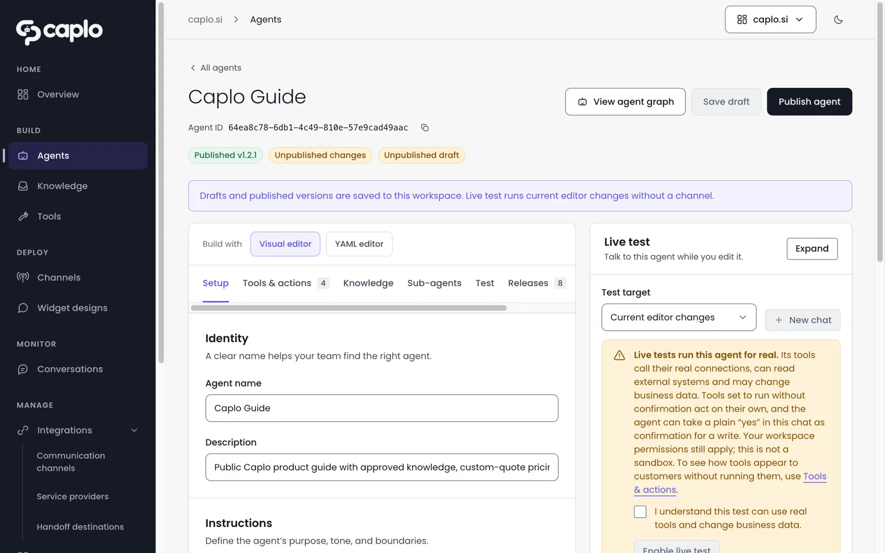

# Set instructions and model

> Name an agent, write its instructions and greeting, and choose the model, temperature, response limit and reasoning settings it runs with.

Every agent starts with the same core: a name, instructions that define its behavior, a greeting, and the language model it runs on. These settings live in the agent’s draft. Nothing you change here reaches customers until you [publish a release](/agents/publishing/) and point a channel at it.

## Create an agent and set its basics

**Console**

1. Open **Build > Agents** and select **Create agent**.
2. Enter an **Agent name** and, optionally, a **Description**, then select **Create draft**. The agent opens on its **Setup** tab.
3. Under **Instructions**, write the **Agent instructions** and the **Greeting message**.
4. Expand **Advanced settings** and choose a **Model**. Adjust **Temperature** and **Response limit** if you need to.
5. Select **Save draft**.



You need a role that can build agents (Owner, Admin or Builder) to edit a draft. Only Owners and Admins can publish it.

**CLI**

Write a starter agent file, edit it, then save it as the agent’s draft:

```plaintext
caplo agent init -f support.yaml --name "Support Desk"
caplo agent validate -f support.yaml
caplo agent push -f support.yaml
```

`caplo agent push` creates the agent when the workspace has no agent with that name, and otherwise replaces its draft. The basics look like this in the file:

```plaintext
name: Support Desk
description: Answers order and returns questions.
instructions: |-
  You are the Northwind support agent.
  Answer questions about orders, delivery and returns.
  If you do not know something, say so instead of guessing.
greeting: Hi, how can I help with your order today?
model:
  provider: Anthropic
  name: claude-haiku-4-5-20251001
  temperature: 0.4
  responseLimit: 800
```

See [Agent YAML](/agents/agent-yaml/) for the whole file.

## Fields

| Console label          | YAML field                     | Required | Limits and default                                              |
| ---------------------- | ------------------------------ | -------- | --------------------------------------------------------------- |
| **Agent name**         | `name`                         | Yes      | Up to 80 characters. Unique in the workspace, ignoring case.    |
| **Description**        | `description`                  | No       | Up to 240 characters. What the agent helps with, for your team. |
| **Agent instructions** | `instructions`                 | Yes      | Plain text.                                                     |
| **Greeting message**   | `greeting`                     | Yes      | The first message of every new conversation on a channel.       |
| **Model**              | `model.provider`, `model.name` | Yes      | A provider and model from the workspace’s model list.           |
| **Temperature**        | `model.temperature`            | No       | 0 to 1. Default 0.4.                                            |
| **Response limit**     | `model.responseLimit`          | No       | 64 to 128,000 tokens. Default 1,024.                            |

### Instructions

The instructions are the agent’s standing brief: its purpose, tone, what it may and may not do, and when to use its tools, knowledge and sub-agents. Keep them about behavior. Channel and voice settings belong to the channel, not here, so the same agent can serve several channels.

Caplo adds a short block of platform guidance and a reply style after your instructions on every turn, for example asking the agent to answer only from its instructions, the conversation and its tool results. You can replace or turn off those blocks in the agent’s [policy](/agents/policy-and-limits/).

Practical tips:

* Name the tools and sub-agents the agent should use, and when. The model sees their descriptions, but a sentence in the instructions makes the choice reliable.
* Say what to do when the agent cannot answer: ask a question, say it does not know, or offer a person.
* Put facts that change often in a [knowledge base](/agents/knowledge/) or a [tool](/agents/tools/), not in the instructions, so you can update them without editing the agent.

### Greeting

The greeting opens every new conversation when the agent serves a channel and starts every test chat. A draft without one cannot be tested or published.

## Choose a model

The **Model** list shows the models Caplo can run for this workspace, grouped by provider (Anthropic and OpenAI). Each model shows where its calls are billed:

* **Caplo Managed**: Caplo’s provider account, charged to your workspace usage.
* **Your key**: your own provider key, set in **Manage > Integrations > Service providers**. See [Bring your own key](/providers/bring-your-own-key/).

A provider that is turned off in Integrations shows **Enable in Integrations** and cannot be chosen. If the draft names a model the workspace no longer offers, it shows as **Not available in this environment**, and you must pick another model before you can test or publish.

In an agent file, `model.provider` is the provider’s display name (`Anthropic` or `OpenAI`) and `model.name` is the model ID shown in the console list, such as `claude-haiku-4-5-20251001`. The CLI does not list models; read the IDs from the console.

Changing the provider or model of a published agent suggests a major version bump when you publish, because answers can change in kind.

### Temperature and response limit

**Temperature** controls how varied replies are. Lower values give more consistent answers, which suits support and transactional agents; the default 0.4 is a good start.

**Response limit** is the most tokens one reply may use. Each model also has a tested maximum output, and Caplo checks the limit against it when you test or publish, so a value above the model’s maximum is refused at that point rather than when you save. A thinking budget, if you set one, counts toward this limit.

## Reasoning settings

Some models can reason before they reply. Reasoning can improve answers to multi-step questions, at the cost of slower and more expensive turns. Set it under **Advanced settings > Agent loop**, or in the agent file’s `policy.reasoning`:

| Console label        | YAML field                              | Values                                                                    | Applies to                                                                      |
| -------------------- | --------------------------------------- | ------------------------------------------------------------------------- | ------------------------------------------------------------------------------- |
| **Reasoning effort** | `policy.reasoning.effort`               | `low`, `medium`, `high` (console: **Off**, **Low**, **Medium**, **High**) | Models that take a reasoning effort. Other models ignore it.                    |
| **Thinking budget**  | `policy.reasoning.thinkingBudgetTokens` | 1,024 to 32,000 tokens                                                    | Extended thinking on Anthropic models. Must be smaller than the response limit. |

```plaintext
policy:
  reasoning:
    thinkingBudgetTokens: 2048
```

A `reasoning` block needs at least one of the two fields. Leave both out to use the model’s own behavior.

Note

Voice settings (the language and voice an agent speaks with on calls) are set in the console under **Advanced settings > Voice** and are not part of the agent file. See [Voice and speech](/providers/voice-and-speech/).

## Next steps

* [Add knowledge](/agents/knowledge/) and [tools](/agents/tools/) to the agent.
* [Tune the agent loop](/agents/policy-and-limits/) if the defaults do not fit.
* [Test the agent](/agents/testing/) before you publish it.
