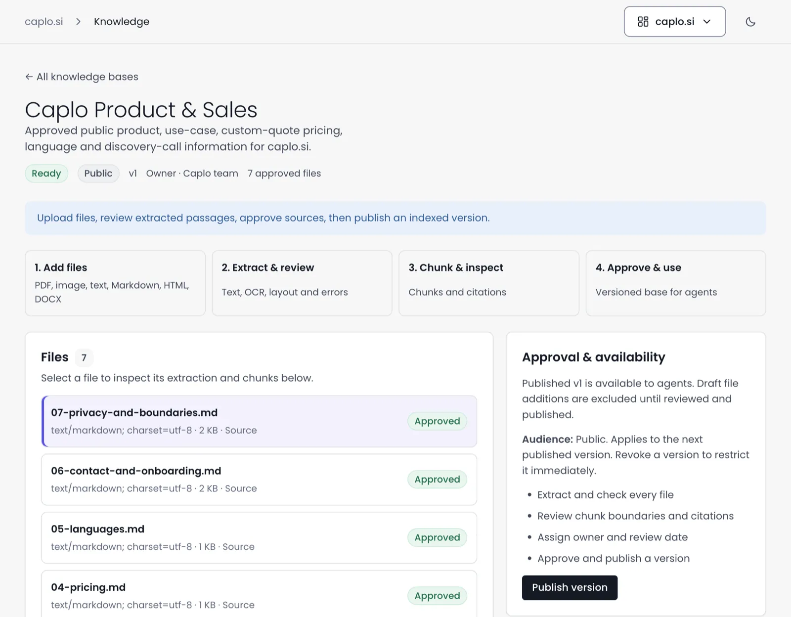
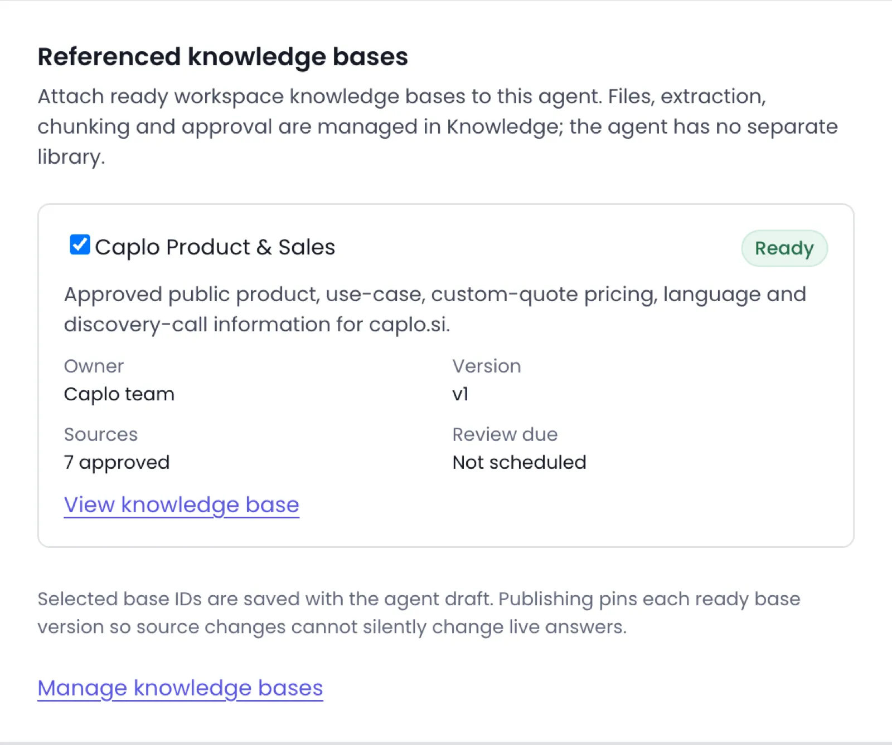

# Add knowledge

> Create a knowledge base, upload and review documents, publish a version, and attach it to an agent from the console or with caplo knowledge.

A knowledge base holds documents an agent answers from: policies, FAQs, product guides. You manage it once in the workspace and attach it to any agent that needs it. Each upload is extracted to text and waits for review; publishing snapshots the approved documents into a version, and an agent release pins the version that was ready when it published. For how retrieval works, see [Knowledge](/concepts/knowledge/).

## Supported files

| Type                           | Extensions                       |
| ------------------------------ | -------------------------------- |
| Text and Markdown              | `.txt`, `.md`, `.markdown`       |
| Web pages                      | `.html`                          |
| Documents                      | `.pdf`, `.docx`                  |
| Images (text is read with OCR) | `.png`, `.jpg`, `.jpeg`, `.webp` |

Each file can be up to 25 MiB. A knowledge base names documents by file name, so two documents in one base cannot share a name.

## Create a knowledge base and add documents

**Console**

1. Open **Build > Knowledge** and select **Create knowledge base**.
2. Enter a **Name** and an **Owner** (the team responsible for the content), and optionally a **Description**. Choose the **Audience** (see [Audience](#audience)), then select **Create draft**.
3. Under **Files**, select **Choose files**, pick up to 20 files, and select **Add to draft**. Each file shows **Extracting** while Caplo reads it.
4. When a file shows **In review**, select it and check **Document review**: the **Extracted text** tab shows what was read, and **Chunks** shows the passages an agent can retrieve. Look for missing pages, tables, image text and anything sensitive.
5. Select **Approve** on each file that is correct. A file that shows **Failed** could not be extracted; upload a corrected copy.
6. Under **Approval & availability**, select **Publish version**. Caplo indexes the approved files; the base shows **Ready** when the version can be used.



Owners, Admins and Builders can create bases and upload files. Approving files and publishing versions need an Owner or Admin.

**CLI**

```plaintext
caplo knowledge create "Returns policy" --owner "Support operations" --description "Returns, exchanges and refunds"
caplo knowledge sync "Returns policy" ./docs/returns --dry-run
caplo knowledge sync "Returns policy" ./docs/returns
caplo knowledge get "Returns policy"
```

`caplo knowledge get` lists each document with its extraction and review state. Review the extracted text in the console, then approve and publish:

```plaintext
caplo knowledge approve "Returns policy"
caplo knowledge publish "Returns policy"
```

`caplo knowledge approve` waits for extraction to finish and approves every document awaiting review, or only the documents you name. It fails if a document cannot be extracted. `caplo knowledge publish` publishes a version from the approved documents and waits until it is indexed. Both wait up to 15 minutes by default; change it with `--timeout`.

Approving with the CLI skips reading the extracted text. Do it when you trust the source files, for example Markdown your team maintains.

## Keep a knowledge base in sync with a folder

`caplo knowledge sync` makes a knowledge base’s documents match a directory tree, so you can keep the source files in a repository and publish from CI:

```plaintext
caplo knowledge sync "Returns policy" ./docs/returns --approve --publish --yes
```

What it does:

* Uploads new files and files whose content changed. Files are matched by name and content, so an unchanged file is not uploaded again.
* Removes documents whose file is gone from the directory. It asks first; `--yes` skips the question.
* Replaces a changed file’s older copy only after the new copy is approved, so a published version never lacks the document.
* Skips hidden files and directories and unsupported file types, and fails if two files in the tree share a name.

With `--approve` it waits for extraction and approves the directory’s documents. With `--publish` it then publishes a version and waits for it to index. `--dry-run` prints the changes without making them. Approving and publishing need an Owner or Admin, or an API key with the `agents:publish` scope.

Caution

Removing a document takes it out of the next version. Versions already published keep it, and agent releases that pin those versions keep answering from it until you publish a new agent release.

AI prompt

Sync a docs folder into a Caplo knowledge base

Keeps a knowledge base in step with a folder in this repository, by hand or from CI, with caplo knowledge sync.

[Open in Claude](https://claude.ai/new?q=Goal%3A%20keep%20the%20Caplo%20knowledge%20base%20%3CKNOWLEDGE_BASE_NAME%3E%20in%20step%20with%20the%20folder%20%3CDOCS_DIR%3E%20in%20this%20repository%2C%20so%20an%20agent%20answers%20from%20the%20same%20documents%20the%20team%20maintains%20here.%0A%0ARead%20these%20pages%20first%3A%0A-%20https%3A%2F%2Fdocs.caplo.si%2Fagents%2Fknowledge.md%0A-%20https%3A%2F%2Fdocs.caplo.si%2Freference%2Fcli%2Fknowledge.md%0A-%20https%3A%2F%2Fdocs.caplo.si%2Fcli%2Fci-cd.md%20\(only%20if%20you%20set%20up%20CI\)%0A%0ASteps%3A%0A1.%20Check%20the%20CLI%20and%20the%20workspace%3A%20run%20%60caplo%20auth%20status%60.%20If%20it%20is%20not%20signed%20in%2C%20ask%20me%20to%20run%20%60caplo%20auth%20login%60%3B%20never%20ask%20for%20or%20handle%20my%20password.%0A2.%20Check%20the%20folder.%20Supported%20types%20are%20.txt%20.md%20.markdown%20.html%20.pdf%20.docx%20.png%20.jpg%20.jpeg%20.webp%2C%20up%20to%2025%20MiB%20each.%20Every%20file%20name%20must%20be%20unique%20across%20the%20whole%20tree%2C%20because%20the%20knowledge%20base%20names%20documents%20by%20file%20name.%20Hidden%20files%20and%20other%20types%20are%20skipped.%20Report%20any%20duplicates%20or%20oversized%20files%20and%20stop%20until%20I%20decide.%0A3.%20If%20the%20knowledge%20base%20does%20not%20exist%20yet%20\(%60caplo%20knowledge%20list%60\)%2C%20create%20it%3A%20%60caplo%20knowledge%20create%20%22%3CKNOWLEDGE_BASE_NAME%3E%22%20--owner%20%22%3COWNER_TEAM%3E%22%20--description%20%22%3CWHAT_IT_COVERS%3E%22%60.%20Add%20%60--audience%20verified_customer%60%20only%20if%20I%20say%20the%20content%20is%20for%20signed-in%20customers%20only.%0A4.%20Preview%20the%20sync%3A%20%60caplo%20knowledge%20sync%20%22%3CKNOWLEDGE_BASE_NAME%3E%22%20%3CDOCS_DIR%3E%20--dry-run%60.%20Show%20me%20the%20uploads%20and%20removals.%0A5.%20After%20I%20approve%20the%20preview%2C%20run%20the%20sync%20without%20%60--dry-run%60.%20Ask%20me%20before%20passing%20%60--approve%60%2C%20%60--publish%60%20or%20%60--yes%60%3A%20approving%20skips%20reviewing%20the%20extracted%20text%20in%20the%20console%2C%20publishing%20makes%20a%20new%20version%2C%20and%20%60--yes%60%20removes%20documents%20whose%20files%20are%20gone%20without%20asking.%0A6.%20If%20I%20want%20CI%20to%20keep%20it%20in%20sync%2C%20add%20a%20job%20that%20runs%20on%20changes%20under%20%3CDOCS_DIR%3E%20on%20the%20default%20branch%3A%20%60caplo%20knowledge%20sync%20%22%3CKNOWLEDGE_BASE_NAME%3E%22%20%3CDOCS_DIR%3E%20--approve%20--publish%20--yes%60.%20Authenticate%20it%20with%20an%20API%20key%20in%20the%20CI%20secret%20store%20as%20CAPLO_API_KEY%2C%20and%20set%20CAPLO_WORKSPACE%20to%20the%20workspace%20ID.%20The%20key%20needs%20the%20agents%3Apublish%20scope%20to%20approve%20and%20publish.%0A%0AVerify%3A%0A-%20%60caplo%20knowledge%20get%20%22%3CKNOWLEDGE_BASE_NAME%3E%22%60%20lists%20every%20file%20from%20the%20folder%2C%20approved%2C%20and%20a%20newest%20version%20that%20is%20ready.%0A-%20Tell%20me%20that%20agents%20already%20published%20keep%20the%20knowledge%20version%20their%20release%20pinned%3B%20they%20use%20the%20new%20version%20only%20after%20their%20next%20release.%0A%0ARules%3A%0A-%20Never%20paste%20API%20keys%20or%20tokens%20into%20files%2C%20commits%2C%20logs%20or%20this%20chat.%20CI%20reads%20the%20key%20from%20its%20secret%20store.%0A-%20Do%20not%20publish%20a%20knowledge%20version%20or%20remove%20documents%20without%20my%20explicit%20go-ahead.%0A-%20Do%20not%20change%20agents%20or%20publish%20agent%20releases%20as%20part%20of%20this%20task.)[Open in ChatGPT](https://chatgpt.com/?q=Goal%3A%20keep%20the%20Caplo%20knowledge%20base%20%3CKNOWLEDGE_BASE_NAME%3E%20in%20step%20with%20the%20folder%20%3CDOCS_DIR%3E%20in%20this%20repository%2C%20so%20an%20agent%20answers%20from%20the%20same%20documents%20the%20team%20maintains%20here.%0A%0ARead%20these%20pages%20first%3A%0A-%20https%3A%2F%2Fdocs.caplo.si%2Fagents%2Fknowledge.md%0A-%20https%3A%2F%2Fdocs.caplo.si%2Freference%2Fcli%2Fknowledge.md%0A-%20https%3A%2F%2Fdocs.caplo.si%2Fcli%2Fci-cd.md%20\(only%20if%20you%20set%20up%20CI\)%0A%0ASteps%3A%0A1.%20Check%20the%20CLI%20and%20the%20workspace%3A%20run%20%60caplo%20auth%20status%60.%20If%20it%20is%20not%20signed%20in%2C%20ask%20me%20to%20run%20%60caplo%20auth%20login%60%3B%20never%20ask%20for%20or%20handle%20my%20password.%0A2.%20Check%20the%20folder.%20Supported%20types%20are%20.txt%20.md%20.markdown%20.html%20.pdf%20.docx%20.png%20.jpg%20.jpeg%20.webp%2C%20up%20to%2025%20MiB%20each.%20Every%20file%20name%20must%20be%20unique%20across%20the%20whole%20tree%2C%20because%20the%20knowledge%20base%20names%20documents%20by%20file%20name.%20Hidden%20files%20and%20other%20types%20are%20skipped.%20Report%20any%20duplicates%20or%20oversized%20files%20and%20stop%20until%20I%20decide.%0A3.%20If%20the%20knowledge%20base%20does%20not%20exist%20yet%20\(%60caplo%20knowledge%20list%60\)%2C%20create%20it%3A%20%60caplo%20knowledge%20create%20%22%3CKNOWLEDGE_BASE_NAME%3E%22%20--owner%20%22%3COWNER_TEAM%3E%22%20--description%20%22%3CWHAT_IT_COVERS%3E%22%60.%20Add%20%60--audience%20verified_customer%60%20only%20if%20I%20say%20the%20content%20is%20for%20signed-in%20customers%20only.%0A4.%20Preview%20the%20sync%3A%20%60caplo%20knowledge%20sync%20%22%3CKNOWLEDGE_BASE_NAME%3E%22%20%3CDOCS_DIR%3E%20--dry-run%60.%20Show%20me%20the%20uploads%20and%20removals.%0A5.%20After%20I%20approve%20the%20preview%2C%20run%20the%20sync%20without%20%60--dry-run%60.%20Ask%20me%20before%20passing%20%60--approve%60%2C%20%60--publish%60%20or%20%60--yes%60%3A%20approving%20skips%20reviewing%20the%20extracted%20text%20in%20the%20console%2C%20publishing%20makes%20a%20new%20version%2C%20and%20%60--yes%60%20removes%20documents%20whose%20files%20are%20gone%20without%20asking.%0A6.%20If%20I%20want%20CI%20to%20keep%20it%20in%20sync%2C%20add%20a%20job%20that%20runs%20on%20changes%20under%20%3CDOCS_DIR%3E%20on%20the%20default%20branch%3A%20%60caplo%20knowledge%20sync%20%22%3CKNOWLEDGE_BASE_NAME%3E%22%20%3CDOCS_DIR%3E%20--approve%20--publish%20--yes%60.%20Authenticate%20it%20with%20an%20API%20key%20in%20the%20CI%20secret%20store%20as%20CAPLO_API_KEY%2C%20and%20set%20CAPLO_WORKSPACE%20to%20the%20workspace%20ID.%20The%20key%20needs%20the%20agents%3Apublish%20scope%20to%20approve%20and%20publish.%0A%0AVerify%3A%0A-%20%60caplo%20knowledge%20get%20%22%3CKNOWLEDGE_BASE_NAME%3E%22%60%20lists%20every%20file%20from%20the%20folder%2C%20approved%2C%20and%20a%20newest%20version%20that%20is%20ready.%0A-%20Tell%20me%20that%20agents%20already%20published%20keep%20the%20knowledge%20version%20their%20release%20pinned%3B%20they%20use%20the%20new%20version%20only%20after%20their%20next%20release.%0A%0ARules%3A%0A-%20Never%20paste%20API%20keys%20or%20tokens%20into%20files%2C%20commits%2C%20logs%20or%20this%20chat.%20CI%20reads%20the%20key%20from%20its%20secret%20store.%0A-%20Do%20not%20publish%20a%20knowledge%20version%20or%20remove%20documents%20without%20my%20explicit%20go-ahead.%0A-%20Do%20not%20change%20agents%20or%20publish%20agent%20releases%20as%20part%20of%20this%20task.)

Show prompt

```
Goal: keep the Caplo knowledge base <KNOWLEDGE_BASE_NAME> in step with the folder <DOCS_DIR> in this repository, so an agent answers from the same documents the team maintains here.

Read these pages first:
- https://docs.caplo.si/agents/knowledge.md
- https://docs.caplo.si/reference/cli/knowledge.md
- https://docs.caplo.si/cli/ci-cd.md (only if you set up CI)

Steps:
1. Check the CLI and the workspace: run `caplo auth status`. If it is not signed in, ask me to run `caplo auth login`; never ask for or handle my password.
2. Check the folder. Supported types are .txt .md .markdown .html .pdf .docx .png .jpg .jpeg .webp, up to 25 MiB each. Every file name must be unique across the whole tree, because the knowledge base names documents by file name. Hidden files and other types are skipped. Report any duplicates or oversized files and stop until I decide.
3. If the knowledge base does not exist yet (`caplo knowledge list`), create it: `caplo knowledge create "<KNOWLEDGE_BASE_NAME>" --owner "<OWNER_TEAM>" --description "<WHAT_IT_COVERS>"`. Add `--audience verified_customer` only if I say the content is for signed-in customers only.
4. Preview the sync: `caplo knowledge sync "<KNOWLEDGE_BASE_NAME>" <DOCS_DIR> --dry-run`. Show me the uploads and removals.
5. After I approve the preview, run the sync without `--dry-run`. Ask me before passing `--approve`, `--publish` or `--yes`: approving skips reviewing the extracted text in the console, publishing makes a new version, and `--yes` removes documents whose files are gone without asking.
6. If I want CI to keep it in sync, add a job that runs on changes under <DOCS_DIR> on the default branch: `caplo knowledge sync "<KNOWLEDGE_BASE_NAME>" <DOCS_DIR> --approve --publish --yes`. Authenticate it with an API key in the CI secret store as CAPLO_API_KEY, and set CAPLO_WORKSPACE to the workspace ID. The key needs the agents:publish scope to approve and publish.

Verify:
- `caplo knowledge get "<KNOWLEDGE_BASE_NAME>"` lists every file from the folder, approved, and a newest version that is ready.
- Tell me that agents already published keep the knowledge version their release pinned; they use the new version only after their next release.

Rules:
- Never paste API keys or tokens into files, commits, logs or this chat. CI reads the key from its secret store.
- Do not publish a knowledge version or remove documents without my explicit go-ahead.
- Do not change agents or publish agent releases as part of this task.
```

## Attach a knowledge base to an agent



**Console**

Open the agent, select the **Knowledge** tab, check each knowledge base the agent should use, and select **Save draft**. Only bases that show **Ready** can be selected.

**CLI**

List knowledge bases by name or ID under `knowledgeBases` in the agent file, then push it:

```plaintext
knowledgeBases:
  - Returns policy
```

A name resolves in the workspace the command acts on, so the same file works in every [environment](/cli/environments/). Use the ID if two bases share a name.

The agent searches attached knowledge with a built-in search tool. How many searches it may run per turn and how many passages each returns are set in its [policy](/agents/policy-and-limits/) (`maxSearches` and `knowledgePassages`).

## Languages

Upload files in any language. Caplo reads the language each file is written in, such as English, Urdu or Roman Urdu (Urdu written in Latin letters), and the **Language** column of the file list shows it. Visitors can ask in their own language: the agent writes its search in the language of the files, keeping names, numbers and codes exactly as given, and answers in the visitor’s language. Prices, codes, phone numbers and addresses in the reply are the ones in your files.

## Versions and agent releases

Publishing an agent pins the knowledge version that is ready at that moment. Publishing a newer knowledge version does not change agents already published, so live answers never change without a release. To use the new version, publish a new release of the agent. A release is made from a new draft revision, so save a change to the agent first; see [Publish an agent](/agents/publishing/).

## Audience

The audience decides who may receive a knowledge base’s content:

| Audience            | Console label               | Who gets it                                                         |
| ------------------- | --------------------------- | ------------------------------------------------------------------- |
| `public` (default)  | **Public**                  | Any visitor.                                                        |
| `verified_customer` | **Verified customers only** | Only a customer who has signed in on a channel that allows sign-in. |

Set it when you create the base (`--audience verified_customer` on `caplo knowledge create`). Each published version keeps the audience it was published with. Signing customers in is covered in [Customer-aware tools](/tools/customer-aware-tools/).

## Next steps

* [Test the agent](/agents/testing/) with questions the documents answer.
* Add [eval cases](/agents/evals/) that check answers from the knowledge base.
