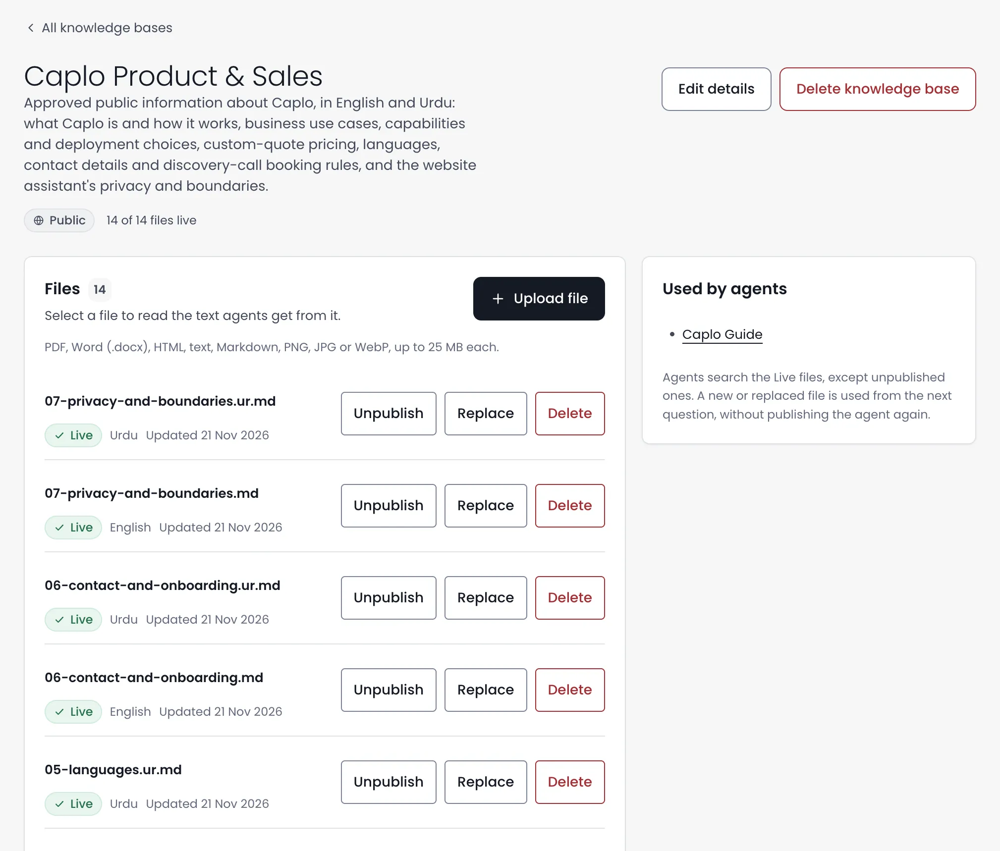

# Add knowledge

> Create a knowledge base, upload files that go live by themselves, keep it in sync with a folder, and attach it to an agent from the console or with caplo knowledge.

A knowledge base holds files an agent answers from: policies, FAQs, price lists, product guides. You manage it once in the workspace and attach it to any agent that needs it. Each uploaded file is read, cut into passages and indexed, and then goes **Live** by itself: from the next question on, every agent that uses the knowledge base can find it, without publishing the agent again. For how retrieval works, see [Knowledge](/concepts/knowledge/).

## Supported files

| Type                           | Extensions                       |
| ------------------------------ | -------------------------------- |
| Text and Markdown              | `.txt`, `.md`, `.markdown`       |
| Web pages                      | `.html`, `.htm`                  |
| Documents                      | `.pdf`, `.docx`                  |
| Images (text is read with OCR) | `.png`, `.jpg`, `.jpeg`, `.webp` |

Each file can be up to 25 MiB. A file whose content is already in the knowledge base is refused. How many files and how much storage a workspace may use depends on its plan; see [Plan limits](/billing/plan-limits/).

## Create a knowledge base and add files

**Console**

1. Open **Build > Knowledge** and select **Create knowledge base**.
2. Enter a **Name** and a **Description**. Agents read the description to decide when to search the knowledge base, so say what it covers. Choose the **Audience** (see [Audience](#audience)), then select **Create knowledge base**.
3. Select **Upload file** and pick one or more files. Each file shows **Processing** while Caplo reads it, then turns **Live** by itself.
4. Select a file to read the text agents get from it, by section and page. Look for missing pages, broken tables and unreadable images.
5. Under **Try a question**, ask what a customer might ask. You see the passages an agent would get and how well each one matches.



A file that shows **Could not read this file** says why; replace it with a readable copy. Owners, Admins and Builders can create knowledge bases and manage their files.

**CLI**

```plaintext
caplo knowledge create "Returns policy" --description "Returns, exchanges and refunds"
caplo knowledge files upload "Returns policy" ./refunds.pdf --wait
caplo knowledge files list "Returns policy"
caplo knowledge search "Returns policy" "How long do I have to return a jacket?"
```

`--wait` waits until the file is live, and exits 3 with the reason if it could not be read. `caplo knowledge search` prints the passages an agent would get for a question, with how well each matches. `caplo knowledge files passages` prints all of a file’s passages.

## Change, unpublish or delete files

Changes to files reach agents from the next question:

| Action    | Console       | CLI                                                   | What agents see                                                                                                                                                                                       |
| --------- | ------------- | ----------------------------------------------------- | ----------------------------------------------------------------------------------------------------------------------------------------------------------------------------------------------------- |
| Replace   | **Replace**   | `caplo knowledge files replace <kb> <file-id> <path>` | The current content keeps answering until the new content is live. If the new content cannot be read, the current content stays live and the file shows **Live, replacement failed** with the reason. |
| Unpublish | **Unpublish** | `caplo knowledge files unpublish <kb> <file-id>`      | Agents stop answering from the file at once. It stays stored and indexed, so publishing it again is instant.                                                                                          |
| Publish   | **Publish**   | `caplo knowledge files publish <kb> <file-id>`        | An unpublished file is used again.                                                                                                                                                                    |
| Delete    | **Delete**    | `caplo knowledge files delete <kb> <file-id>`         | Agents stop finding the file at once. This cannot be undone.                                                                                                                                          |

`caplo knowledge files list` shows each file’s ID.

## Keep a knowledge base in sync with a folder

`caplo knowledge sync` makes a knowledge base’s files match a directory tree, so you can keep the source files in a repository and sync them from CI:

```plaintext
caplo knowledge sync "Returns policy" ./docs/returns --dry-run
caplo knowledge sync "Returns policy" ./docs/returns --yes --wait
```

What it does:

* Uploads new files and replaces files whose content changed. Files are matched by name, so an unchanged file is not uploaded again and two files in the tree may not share a name.
* Deletes the files whose name is gone from the directory. It asks first; `--yes` skips the question.
* Keeps a replaced file answering with its previous content until the new content is live.
* Skips hidden files and directories and unsupported file types.

`--wait` waits until every uploaded file is live, and exits 3 with the reasons when any could not be read. `--dry-run` prints the changes without making them. If the workspace reaches a plan limit, the sync stops before deleting anything. In CI, authenticate with an [API key](/cli/authentication/) that has the `agents:write` scope.

AI prompt

Sync a docs folder into a Caplo knowledge base

Keeps a knowledge base in step with a folder in this repository, by hand or from CI, with caplo knowledge sync.

[Open in Claude](https://claude.ai/new?q=Goal%3A%20keep%20the%20Caplo%20knowledge%20base%20%3CKNOWLEDGE_BASE_NAME%3E%20in%20step%20with%20the%20folder%20%3CDOCS_DIR%3E%20in%20this%20repository%2C%20so%20an%20agent%20answers%20from%20the%20same%20documents%20the%20team%20maintains%20here.%0A%0ARead%20these%20pages%20first%3A%0A-%20https%3A%2F%2Fdocs.caplo.si%2Fagents%2Fknowledge.md%0A-%20https%3A%2F%2Fdocs.caplo.si%2Freference%2Fcli%2Fknowledge.md%0A-%20https%3A%2F%2Fdocs.caplo.si%2Fcli%2Fci-cd.md%20\(only%20if%20you%20set%20up%20CI\)%0A%0ASteps%3A%0A1.%20Check%20the%20CLI%20and%20the%20workspace%3A%20run%20%60caplo%20auth%20status%60.%20If%20it%20is%20not%20signed%20in%2C%20ask%20me%20to%20run%20%60caplo%20auth%20login%60%3B%20never%20ask%20for%20or%20handle%20my%20password.%0A2.%20Check%20the%20folder.%20Supported%20types%20are%20.txt%20.md%20.markdown%20.html%20.htm%20.pdf%20.docx%20.png%20.jpg%20.jpeg%20.webp%2C%20up%20to%2025%20MiB%20each.%20File%20names%20must%20be%20unique%20across%20the%20whole%20tree%2C%20because%20the%20sync%20matches%20files%20by%20name.%20Hidden%20files%20and%20other%20types%20are%20skipped.%20Report%20any%20duplicates%20or%20oversized%20files%20and%20stop%20until%20I%20decide.%0A3.%20If%20the%20knowledge%20base%20does%20not%20exist%20yet%20\(%60caplo%20knowledge%20list%60\)%2C%20create%20it%3A%20%60caplo%20knowledge%20create%20%22%3CKNOWLEDGE_BASE_NAME%3E%22%20--description%20%22%3CWHAT_IT_COVERS%3E%22%60.%20Agents%20read%20the%20description%20to%20decide%20when%20to%20search%2C%20so%20say%20what%20the%20files%20cover.%20Add%20%60--audience%20verified_customer%60%20only%20if%20I%20say%20the%20content%20is%20for%20signed-in%20customers%20only.%0A4.%20Preview%20the%20sync%3A%20%60caplo%20knowledge%20sync%20%22%3CKNOWLEDGE_BASE_NAME%3E%22%20%3CDOCS_DIR%3E%20--dry-run%60.%20Show%20me%20the%20uploads%2C%20replacements%20and%20deletions.%0A5.%20After%20I%20approve%20the%20preview%2C%20run%20it%20with%20%60--wait%60%20and%20without%20%60--dry-run%60.%20Uploaded%20files%20go%20live%20by%20themselves%20and%20agents%20using%20the%20knowledge%20base%20answer%20from%20them%20at%20once.%20Ask%20me%20before%20passing%20%60--yes%60%2C%20which%20deletes%20files%20whose%20names%20are%20gone%20from%20the%20folder%20without%20asking.%0A6.%20If%20I%20want%20CI%20to%20keep%20it%20in%20sync%2C%20add%20a%20job%20that%20runs%20on%20changes%20under%20%3CDOCS_DIR%3E%20on%20the%20default%20branch%3A%20%60caplo%20knowledge%20sync%20%22%3CKNOWLEDGE_BASE_NAME%3E%22%20%3CDOCS_DIR%3E%20--yes%20--wait%60.%20Authenticate%20it%20with%20an%20API%20key%20in%20the%20CI%20secret%20store%20as%20CAPLO_API_KEY%2C%20and%20set%20CAPLO_WORKSPACE%20to%20the%20workspace%20ID.%20The%20key%20needs%20the%20agents%3Awrite%20scope.%0A%0AVerify%3A%0A-%20%60caplo%20knowledge%20files%20list%20%22%3CKNOWLEDGE_BASE_NAME%3E%22%60%20lists%20every%20file%20from%20the%20folder%20as%20live.%0A-%20%60caplo%20knowledge%20search%20%22%3CKNOWLEDGE_BASE_NAME%3E%22%20%22%3CA_QUESTION_THE_FILES_ANSWER%3E%22%60%20returns%20passages%20from%20those%20files.%0A%0ARules%3A%0A-%20Never%20paste%20API%20keys%20or%20tokens%20into%20files%2C%20commits%2C%20logs%20or%20this%20chat.%20CI%20reads%20the%20key%20from%20its%20secret%20store.%0A-%20Do%20not%20upload%20to%20a%20knowledge%20base%20live%20agents%20use%2C%20or%20delete%20files%2C%20without%20my%20explicit%20go-ahead.%0A-%20Do%20not%20change%20agents%20or%20publish%20agent%20releases%20as%20part%20of%20this%20task.)[Open in ChatGPT](https://chatgpt.com/?q=Goal%3A%20keep%20the%20Caplo%20knowledge%20base%20%3CKNOWLEDGE_BASE_NAME%3E%20in%20step%20with%20the%20folder%20%3CDOCS_DIR%3E%20in%20this%20repository%2C%20so%20an%20agent%20answers%20from%20the%20same%20documents%20the%20team%20maintains%20here.%0A%0ARead%20these%20pages%20first%3A%0A-%20https%3A%2F%2Fdocs.caplo.si%2Fagents%2Fknowledge.md%0A-%20https%3A%2F%2Fdocs.caplo.si%2Freference%2Fcli%2Fknowledge.md%0A-%20https%3A%2F%2Fdocs.caplo.si%2Fcli%2Fci-cd.md%20\(only%20if%20you%20set%20up%20CI\)%0A%0ASteps%3A%0A1.%20Check%20the%20CLI%20and%20the%20workspace%3A%20run%20%60caplo%20auth%20status%60.%20If%20it%20is%20not%20signed%20in%2C%20ask%20me%20to%20run%20%60caplo%20auth%20login%60%3B%20never%20ask%20for%20or%20handle%20my%20password.%0A2.%20Check%20the%20folder.%20Supported%20types%20are%20.txt%20.md%20.markdown%20.html%20.htm%20.pdf%20.docx%20.png%20.jpg%20.jpeg%20.webp%2C%20up%20to%2025%20MiB%20each.%20File%20names%20must%20be%20unique%20across%20the%20whole%20tree%2C%20because%20the%20sync%20matches%20files%20by%20name.%20Hidden%20files%20and%20other%20types%20are%20skipped.%20Report%20any%20duplicates%20or%20oversized%20files%20and%20stop%20until%20I%20decide.%0A3.%20If%20the%20knowledge%20base%20does%20not%20exist%20yet%20\(%60caplo%20knowledge%20list%60\)%2C%20create%20it%3A%20%60caplo%20knowledge%20create%20%22%3CKNOWLEDGE_BASE_NAME%3E%22%20--description%20%22%3CWHAT_IT_COVERS%3E%22%60.%20Agents%20read%20the%20description%20to%20decide%20when%20to%20search%2C%20so%20say%20what%20the%20files%20cover.%20Add%20%60--audience%20verified_customer%60%20only%20if%20I%20say%20the%20content%20is%20for%20signed-in%20customers%20only.%0A4.%20Preview%20the%20sync%3A%20%60caplo%20knowledge%20sync%20%22%3CKNOWLEDGE_BASE_NAME%3E%22%20%3CDOCS_DIR%3E%20--dry-run%60.%20Show%20me%20the%20uploads%2C%20replacements%20and%20deletions.%0A5.%20After%20I%20approve%20the%20preview%2C%20run%20it%20with%20%60--wait%60%20and%20without%20%60--dry-run%60.%20Uploaded%20files%20go%20live%20by%20themselves%20and%20agents%20using%20the%20knowledge%20base%20answer%20from%20them%20at%20once.%20Ask%20me%20before%20passing%20%60--yes%60%2C%20which%20deletes%20files%20whose%20names%20are%20gone%20from%20the%20folder%20without%20asking.%0A6.%20If%20I%20want%20CI%20to%20keep%20it%20in%20sync%2C%20add%20a%20job%20that%20runs%20on%20changes%20under%20%3CDOCS_DIR%3E%20on%20the%20default%20branch%3A%20%60caplo%20knowledge%20sync%20%22%3CKNOWLEDGE_BASE_NAME%3E%22%20%3CDOCS_DIR%3E%20--yes%20--wait%60.%20Authenticate%20it%20with%20an%20API%20key%20in%20the%20CI%20secret%20store%20as%20CAPLO_API_KEY%2C%20and%20set%20CAPLO_WORKSPACE%20to%20the%20workspace%20ID.%20The%20key%20needs%20the%20agents%3Awrite%20scope.%0A%0AVerify%3A%0A-%20%60caplo%20knowledge%20files%20list%20%22%3CKNOWLEDGE_BASE_NAME%3E%22%60%20lists%20every%20file%20from%20the%20folder%20as%20live.%0A-%20%60caplo%20knowledge%20search%20%22%3CKNOWLEDGE_BASE_NAME%3E%22%20%22%3CA_QUESTION_THE_FILES_ANSWER%3E%22%60%20returns%20passages%20from%20those%20files.%0A%0ARules%3A%0A-%20Never%20paste%20API%20keys%20or%20tokens%20into%20files%2C%20commits%2C%20logs%20or%20this%20chat.%20CI%20reads%20the%20key%20from%20its%20secret%20store.%0A-%20Do%20not%20upload%20to%20a%20knowledge%20base%20live%20agents%20use%2C%20or%20delete%20files%2C%20without%20my%20explicit%20go-ahead.%0A-%20Do%20not%20change%20agents%20or%20publish%20agent%20releases%20as%20part%20of%20this%20task.)

Show prompt

```
Goal: keep the Caplo knowledge base <KNOWLEDGE_BASE_NAME> in step with the folder <DOCS_DIR> in this repository, so an agent answers from the same documents the team maintains here.

Read these pages first:
- https://docs.caplo.si/agents/knowledge.md
- https://docs.caplo.si/reference/cli/knowledge.md
- https://docs.caplo.si/cli/ci-cd.md (only if you set up CI)

Steps:
1. Check the CLI and the workspace: run `caplo auth status`. If it is not signed in, ask me to run `caplo auth login`; never ask for or handle my password.
2. Check the folder. Supported types are .txt .md .markdown .html .htm .pdf .docx .png .jpg .jpeg .webp, up to 25 MiB each. File names must be unique across the whole tree, because the sync matches files by name. Hidden files and other types are skipped. Report any duplicates or oversized files and stop until I decide.
3. If the knowledge base does not exist yet (`caplo knowledge list`), create it: `caplo knowledge create "<KNOWLEDGE_BASE_NAME>" --description "<WHAT_IT_COVERS>"`. Agents read the description to decide when to search, so say what the files cover. Add `--audience verified_customer` only if I say the content is for signed-in customers only.
4. Preview the sync: `caplo knowledge sync "<KNOWLEDGE_BASE_NAME>" <DOCS_DIR> --dry-run`. Show me the uploads, replacements and deletions.
5. After I approve the preview, run it with `--wait` and without `--dry-run`. Uploaded files go live by themselves and agents using the knowledge base answer from them at once. Ask me before passing `--yes`, which deletes files whose names are gone from the folder without asking.
6. If I want CI to keep it in sync, add a job that runs on changes under <DOCS_DIR> on the default branch: `caplo knowledge sync "<KNOWLEDGE_BASE_NAME>" <DOCS_DIR> --yes --wait`. Authenticate it with an API key in the CI secret store as CAPLO_API_KEY, and set CAPLO_WORKSPACE to the workspace ID. The key needs the agents:write scope.

Verify:
- `caplo knowledge files list "<KNOWLEDGE_BASE_NAME>"` lists every file from the folder as live.
- `caplo knowledge search "<KNOWLEDGE_BASE_NAME>" "<A_QUESTION_THE_FILES_ANSWER>"` returns passages from those files.

Rules:
- Never paste API keys or tokens into files, commits, logs or this chat. CI reads the key from its secret store.
- Do not upload to a knowledge base live agents use, or delete files, without my explicit go-ahead.
- Do not change agents or publish agent releases as part of this task.
```

## Attach a knowledge base to an agent


**Console**

Open the agent and its **Abilities**. Under **Knowledge**, select **Add**, check each knowledge base the agent should use, select **Done**, then **Save draft**.

**CLI**

List knowledge bases by name or ID under `knowledgeBases` in the agent file, then push it:

```plaintext
knowledgeBases:
  - Returns policy
```

A name resolves in the workspace the command acts on, so the same file works in every [environment](/cli/environments/). Use the ID if two bases share a name.

The agent searches attached knowledge with a built-in search tool. How many searches it may run per turn and how many passages each returns are set in its [policy](/agents/policy-and-limits/) (`maxSearches` and `knowledgePassages`). An agent can use up to 8 knowledge bases.

## Languages

Upload files in any language. Caplo reads the language each file is written in, such as English, Urdu or Roman Urdu (Urdu written in Latin letters), and the **Language** column of the file list shows it. Visitors can ask in their own language: the agent writes its search in the language of the files, keeping names, numbers and codes exactly as given, and answers in the visitor’s language. Prices, codes, phone numbers and addresses in the reply are the ones in your files.

## Knowledge and agent releases

Knowledge is not pinned to a release. A release records which knowledge bases the agent uses, with each one’s name and description, and every search reads their live, published files. So:

* New, replaced, unpublished and deleted files change answers from the next question, in every release that uses the knowledge base.
* A new name or description reaches the agent’s model only when you publish the agent again, because the release copied them.
* A knowledge base that agents use cannot be deleted. Caplo names the agents; remove it from them first.

## Audience

The audience decides who may receive a knowledge base’s content:

| Audience            | Console label               | Who gets it                                                         |
| ------------------- | --------------------------- | ------------------------------------------------------------------- |
| `public` (default)  | **Public**                  | Any visitor.                                                        |
| `verified_customer` | **Verified customers only** | Only a customer who has signed in on a channel that allows sign-in. |

Set it when you create the knowledge base (`--audience verified_customer` on `caplo knowledge create`) and change it with **Edit details** or `caplo knowledge update --audience`. A change applies from the next search. Signing customers in is covered in [Customer-aware tools](/tools/customer-aware-tools/).

## Next steps

* [Test the agent](/agents/testing/) with questions the files answer.
* Add [eval cases](/agents/evals/) that check answers from the knowledge base.
