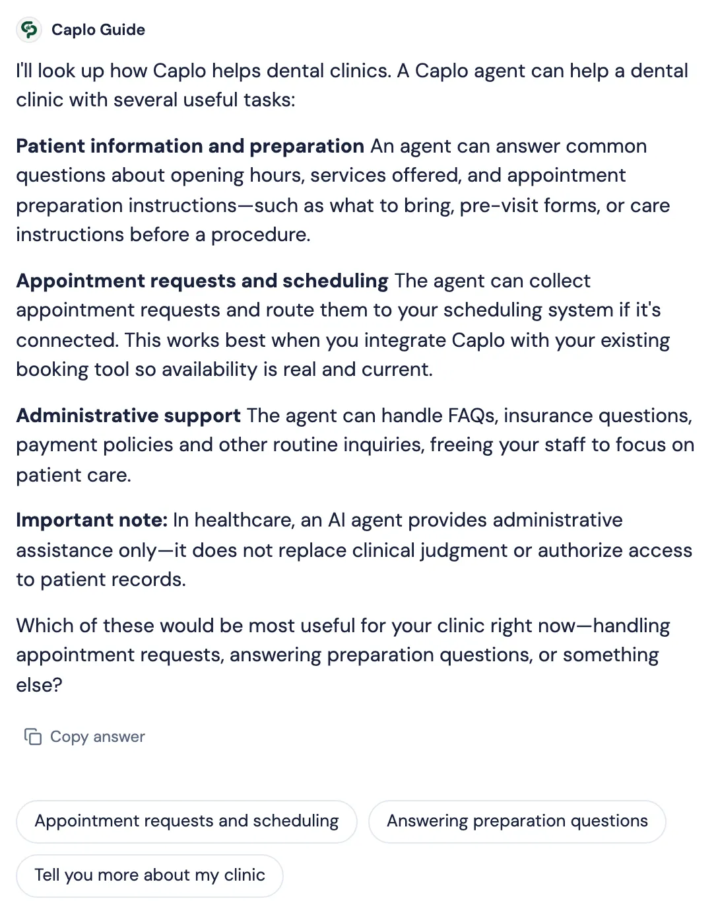

# Offer suggested replies and collect ratings

> Turn on suggested replies under an agent's messages and let website visitors rate its replies, and find the ratings in Conversations.

Two optional agent settings shape what visitors see under the agent’s replies: suggested replies they can tap instead of typing, and a thumbs up or down to rate a reply. Both are off by default. Both are part of the agent’s draft, so they reach customers when you publish a release and a channel serves it.

## Suggested replies

Suggested replies are short next messages, such as “Track my order” or “Talk to a person”, offered under a reply the agent writes. A visitor taps one to send it.



**Console:** open the agent, go to **Setup > Advanced settings > Suggested replies**, turn on **Offer suggested replies**, and set **Most suggestions** (1 to 4). Select **Save draft**.

**Agent YAML:**

```plaintext
suggestedReplies:
  maxCount: 3
```

`maxCount` is the most suggestions under one reply, 1 to 4, and 3 when you leave it out. An empty block (`suggestedReplies: {}`) turns them on with 3. Leave the block out to turn them off.

Where they appear:

* The website widget, the console’s live test, and messaging channels that can show them. `caplo agent chat` does not print them. WhatsApp, Messenger and Instagram show at most 3, as reply buttons, whatever `maxCount` says.
* Never on voice calls.
* Only under replies the agent writes itself. A sub-agent that [takes over the conversation](/agents/sub-agents-and-routing/#modes) uses its own setting; a sub-agent the agent asks for an answer never offers any.

The agent does not offer suggestions when its reply asks for the visitor’s own details, such as a name, email address or order number, since any suggestion would have to invent them. Suggestions come from one extra short model call after the reply, which is counted and billed like the agent’s other model calls. If that call fails or the turn has no budget left for it, the reply is sent without suggestions.

## Visitor ratings

With ratings on, the website widget shows a thumbs up and a thumbs down under the agent’s replies. A visitor who gives a thumbs down can add a reason.

**Console:** open the agent, go to **Setup > Advanced settings > Reply ratings**, turn on **Let visitors rate replies**, and select **Save draft**.

**Agent YAML:**

```plaintext
visitorFeedback: true
```

Leave the field out to turn ratings off.

Ratings apply to the website widget only. The setting is frozen into a channel when the channel is deployed with a release, so after you publish, [deploy the website channel](/agents/publishing/#deploy-a-release-to-channels) to the new release to start collecting ratings.

### Where operators see ratings

Open **Monitor > Conversations** and select a conversation. A rated reply shows **Rated helpful by the visitor** or **Rated not helpful by the visitor**, with the visitor’s reason when they gave one. The rating shown is the visitor’s current one, so a changed vote replaces the earlier rating.

The agent never sees ratings; they do not change its replies. Use them to find answers to fix, then turn those conversations into [eval cases](/agents/evals/) so the fix stays fixed.

## See also

* [Website widget settings](/channels/website-widget/settings/)
* [Conversations and handoff](/concepts/conversations-and-handoff/)
