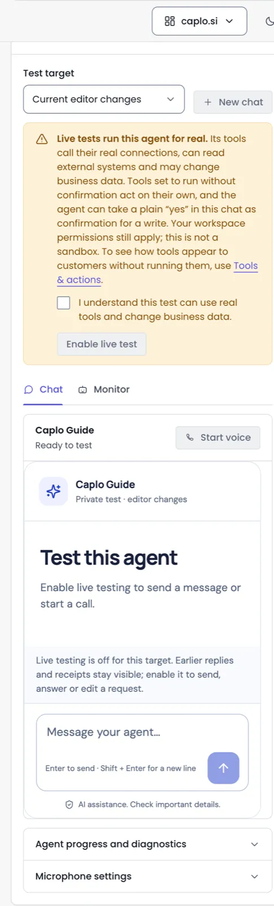

# Test an agent

> Chat with a draft or a release in the console's live test or with caplo agent chat, decide tool writes, and manage your test sessions.

Test an agent by talking to it before customers do. A test runs in a private conversation that no channel serves, against either the current draft or a published release. Tests are for exploring; [eval cases](/agents/evals/) are the repeatable checks that gate publishing.

Tests use real tools

A test is not a sandbox. The agent’s tools call their real connections, can read your systems and can change business data. Tools set to run without confirmation act on their own. Use test accounts and test data in the systems your tools reach.

## Test in the console

The **Live test** panel sits beside the agent editor.

1. Open the agent. In **Live test**, choose the **Test target**: **Current editor changes** (your edits, saved or not) or a **Published** release.
2. The first time, read the notice, check **I understand this test can use real tools and change business data.**, and select **Enable live test**.
3. Type a message, or select **Start voice** to talk to the agent with your microphone. **End call** stops a voice test.
4. When the agent proposes a write, such as creating a return, the chat shows the request with its details. Confirm or cancel it there, as a customer would.
5. After you change the draft, select **Apply changes** to start a new chat with your edits. **New chat** starts over at any time.

**Expand** opens a larger view with the chat and **Monitor** side by side. **Monitor** shows the steps of each turn as the agent works, with filters for agent, step type and **Errors only**. **Agent progress and diagnostics** lists the sub-agents and tools the chat used, with statuses and error codes only. You need a role that can edit the agent (Owner, Admin or Builder) to test it.

A live test follows the confirmation rules of the agent’s tools, and the agent may treat a plain “yes” typed in the chat as confirmation of a write it asked about. Use the buttons when you want an explicit decision.



## Test with the CLI

`caplo agent chat` starts a private test conversation with the agent’s saved draft and reads one message per line:

```plaintext
caplo agent push -f support.yaml
caplo agent chat "Support Desk"
```

It tests the draft as last saved, so push or save your edits first. To test a release instead:

```plaintext
caplo agent chat "Support Desk" --release 2.1.0
```

`--release` takes a version or a release number. Each reply is printed after one line per sub-agent call (its mode and status) and per tool call (its effect and status) that the turn made, so you can see how the agent reached its answer.

### Confirm or cancel writes

When the agent proposes a write, the chat prints the request for review. Answer it with a command on its own line:

| Input                          | Effect                                                              |
| ------------------------------ | ------------------------------------------------------------------- |
| `/confirm`                     | Approves the write shown last, as the widget’s confirm button does. |
| `/cancel`                      | Declines it.                                                        |
| `/exit` or `/quit` (or Ctrl-D) | Ends the chat and closes the test session.                          |

Some writes can only be declined here: one that has no review in the CLI, or one waiting for the customer to sign in. If the write changes before you answer, the current one is shown and you answer again.

You can script a test by piping input:

```plaintext
printf 'Return the boots from order 1042\n/confirm\n' | caplo agent chat "Support Desk"
```

The command exits with status 1 if a message or decision could not be sent, and, when it is not run in a terminal, with status 3 if a turn failed. See [Exit codes](/reference/cli/#exit-codes).

## Test sessions

Each test chat holds a test session, and a workspace has limited test capacity. A chat closes its session when it ends. If a chat stops abruptly or capacity runs out, `caplo agent chat` reports that no test session is free. List and close your open sessions:

```plaintext
caplo agent test list
caplo agent test close 4d2f8b1e-6c3a-4f7e-9d05-1a2b3c4d5e6f
```

`caplo agent test list` shows each of your open sessions across agents with its agent, last activity and how long it may keep running. You can list and close only your own sessions.

## What to test

* The greeting and a few typical questions.
* A question the agent should not answer, and one it cannot answer, to check it says so.
* Each tool: a lookup that succeeds, one that finds nothing, and a write you confirm and one you cancel.
* Each sub-agent, with a message that should route to it and one that should not.
* A request for a person, if the agent can [hand off](/agents/handoff-and-end-actions/).

Turn what you learn into [eval cases](/agents/evals/), then [publish](/agents/publishing/).
