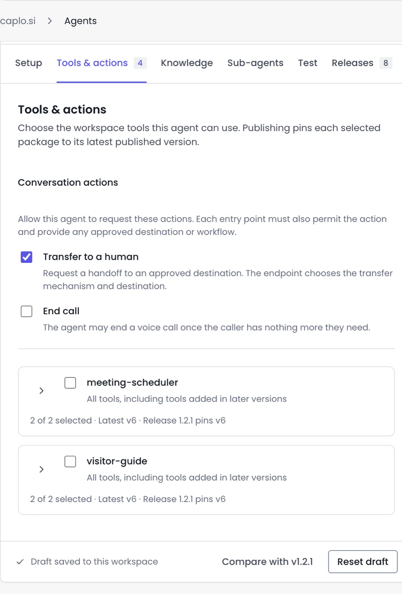

# Give an agent tools

> Attach tool package tools and remote MCP server tools to an agent, name them in agent YAML, and understand how releases pin tool versions.

Tools let an agent look things up and act in your systems: find an order, check stock, book an appointment. An agent can use two kinds of tools:

* **Tool package tools**: code you write and publish in the workspace with the Caplo tool SDK. See [Build tools](/tools/).
* **Remote MCP server tools**: tools of an MCP server you connect to the workspace and publish after review. See [Connect a remote MCP server](/tools/remote-mcp/).

Both appear in the same list on the agent. A tool must be published before an agent release can use it.

## Attach tools

**Console**

1. Open the agent and select the **Tools & actions** tab.
2. Each tool package and remote MCP server is listed as a group. Check the group to give the agent **All tools, including tools added in later versions**, or expand it and check single tools.
3. Select **Details** on a tool to see its description, input and output schemas, whether it reads or writes, and how it appears to customers.
4. Select **Save draft**.



Each group shows how many of its tools are selected, its latest version, and the version the agent’s latest release pins. A tool marked **Blocks publishing if selected** (for example **Build pending**) has no usable published version yet; the agent cannot publish while it is selected.

**CLI**

List the tools under `tools` in the agent file, then push it:

```plaintext
tools:
  - order-desk/lookup_order
  - order-desk/track_shipment
  - helpdesk/create_ticket
```

Then run `caplo push` in a project, or `caplo agent push -f <file>` for a single agent file.

## Tool names in agent YAML

| Form                                    | Meaning                                                                                    |
| --------------------------------------- | ------------------------------------------------------------------------------------------ |
| `<package>/<tool>`                      | One tool of a tool package in your project (`tools/<package>/caplo.yaml`).                 |
| `<package>`                             | Every tool of that project package, including tools added in later versions.               |
| `<server>/<tool>`                       | One published tool of a workspace remote MCP server, by the server’s name.                 |
| `<package ID>/<tool>` or `<package ID>` | A workspace tool package by its ID. This is the form the console’s **Export YAML** writes. |

Inside a project, a name that is not a project package is looked up as a remote MCP server when you run `caplo diff`, `caplo push` or `caplo publish`. Outside a project, names refer to remote MCP servers, and packages are named by ID. Tool names are lowercase letters, digits and underscores, starting with a letter. An agent can reference at most 32 tools or packages.

## How releases pin tool versions

The draft names packages and tools; it does not name versions. When you publish the agent, Caplo resolves each package to its latest published version and freezes that version into the release, together with each tool’s schema and its read or write effect. A release keeps running the tool versions it was published with, even after the package publishes again. If a pinned tool version is revoked, the release can no longer run it; publish a new release that pins a usable version.

To move an agent to newer tool versions, publish a new release:

* `caplo agent publish <agent>` publishes again when the agent’s packages have newer versions, even if the draft has not changed.
* `caplo publish` in a project publishes changed packages first, then republishes every agent that uses them.
* In the console, **Publish agent** needs unpublished draft changes. The publish dialog lists each tool with the exact version and behavior the release will pin.

Selecting a whole package picks up tools the package adds in later versions at your next publish. Selecting single tools keeps the agent to exactly those tools.

Note

Tools that write (create an order, cancel a booking) ask the customer to confirm before they run, unless the tool is set to run without confirmation. Testing an agent in the console or with `caplo agent chat` runs tools against their real connections. See [Test an agent](/agents/testing/).

## Conversation actions

The **Tools & actions** tab also holds the agent’s conversation actions: transfer to a human and ending a voice call. See [Handoff and end actions](/agents/handoff-and-end-actions/).

## Next steps

* [Write a tool package](/tools/first-tool/).
* [Add eval cases](/agents/evals/) that check the agent calls the right tool (`tool` in a case).
