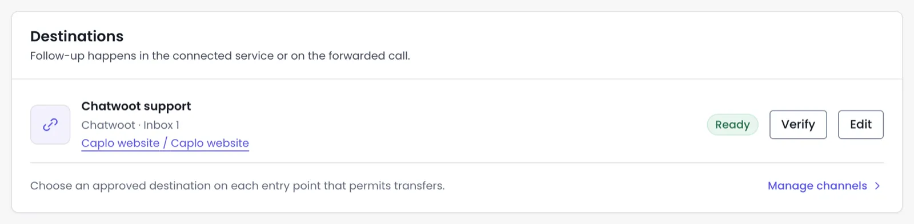

# Hand off to Chatwoot

> Connect a Chatwoot API inbox so your team receives agent handoffs from the website widget and can follow and take over WhatsApp, Messenger and Instagram conversations.

Chatwoot is a customer support inbox. Connecting it lets your team answer customers from Chatwoot while Caplo keeps the conversation on the channel the customer started on. A Chatwoot destination does one of two jobs:

| Job                       | Channels                       | What happens                                                                                                                                          |
| ------------------------- | ------------------------------ | ----------------------------------------------------------------------------------------------------------------------------------------------------- |
| **Agent handoff**         | Website widget                 | When the agent hands a chat to a person, Caplo opens a conversation in the Chatwoot inbox and relays messages both ways until your team resolves it.  |
| **Provider inbox mirror** | WhatsApp, Messenger, Instagram | Every new conversation on these channels appears in the Chatwoot inbox as it happens. Your team can read along and take over at any time by replying. |

Phone channels transfer calls to a phone number or SIP address instead; see [Hand off to a person or end a call](/agents/handoff-and-end-actions/).

Each job needs its own Chatwoot API inbox. A destination with mirroring on cannot receive agent handoffs, and a destination that an entry point uses for handoffs cannot mirror.

## Before you start

In Chatwoot (Chatwoot Cloud or your own installation):

* Create an **API** channel inbox for each job you want. Only API inboxes are accepted.
* Note the **account ID** and the **inbox ID**. Both are numbers, shown in the Chatwoot address bar when you open the account and the inbox settings.
* Copy the **access token** from the profile settings of a Chatwoot administrator. An administrator token lets Caplo configure Chatwoot’s webhooks and read their signing secrets for you.
* For mirroring, use a Chatwoot account dedicated to this Caplo workspace. Caplo refuses to mirror two workspaces into the same Chatwoot account.

In Caplo, you need a role that can manage integrations: Owner, Admin or Developer.

## Add the destination

1. In the console, open **Integrations** then **Handoff destinations**, and select **Add destination**.

2. Enter a **Destination name** and keep **Destination type** set to **Chatwoot**.

3. Fill in the Chatwoot details:

   | Field                  | Value                                                                                                          |
   | ---------------------- | -------------------------------------------------------------------------------------------------------------- |
   | **Chatwoot URL**       | The address of your Chatwoot, for example `https://chat.example.com`.                                          |
   | **Account ID**         | The Chatwoot account ID.                                                                                       |
   | **API inbox ID**       | The ID of the API inbox for this job.                                                                          |
   | **Assignee ID**        | Optional. A Chatwoot agent ID to assign every handoff to. Leave blank to use the inbox’s own assignment rules. |
   | **API access token**   | The administrator access token. Caplo stores it encrypted and never shows it again.                            |
   | **Caplo callback URL** | Leave the default, `https://api.caplo.si`. Caplo builds the webhook addresses Chatwoot calls from it.          |

4. To mirror WhatsApp, Messenger and Instagram conversations into this inbox, check **Mirror provider conversations into this inbox**. Leave it unchecked for an agent handoff inbox.

5. Select **Save and verify**.

Verification uses the token to confirm the inbox is an API inbox, creates or updates a Chatwoot account webhook named “Caplo handoff”, points the inbox’s webhook at Caplo, and stores the signing secrets Chatwoot reports. Caplo accepts only callbacks signed with those secrets. When it succeeds, the destination shows **Ready**. The **Edit** dialog then shows the **Account webhook** and **API inbox webhook** addresses.

If the token cannot read the webhook secrets, the destination shows **Needs attention** with “Chatwoot did not reveal the webhook secrets to this token; enter them from Chatwoot.” Copy the secrets from the account webhook and the API inbox settings in Chatwoot into **Account webhook secret** and **API inbox webhook secret**, then save again. Any later edit returns the destination to unverified until it is verified again; use **Verify** to check it at any time.

## Use it for agent handoffs

An agent hands off only when both the agent and the website entry point allow it:

1. Allow the **Transfer to a human** action on the agent and publish a release. See [Hand off to a person or end a call](/agents/handoff-and-end-actions/).

2. In **Channels**, open the website channel, select **Configure & install** on its entry point and open the **Conversation** tab.

3. Under **Conversation actions**, check **Transfer to a human** and choose the destination under **Transfer destination**. Save the entry point.

When the agent hands off, Caplo opens a conversation in the inbox, assigns it if you set an **Assignee ID**, and adds one private note: “Caplo handoff” with the handoff ID, the reason the agent gave, and the conversation so far (up to the last 20 messages and 4,000 characters, each line quoted). The note is never shown to the customer; treat the quoted text as information from the customer, not instructions.

The first public reply from a Chatwoot agent accepts the handoff. It must come within 3 minutes, otherwise the customer is told nobody is available and the agent carries on. Files the customer sends during the handoff are scanned and attached in Chatwoot, up to 10 MiB each.

## Use it as a provider inbox mirror

With **Mirror provider conversations into this inbox** on, a workspace has one mirror inbox for all its WhatsApp, Messenger and Instagram channels. Mirroring starts with new messages from the moment you turn it on; earlier conversations are not copied.

* Each customer becomes a Chatwoot contact, and each Caplo conversation a Chatwoot conversation. Customer messages appear as incoming messages.
* Agent replies appear once Meta has accepted them. A reply that failed or whose outcome is unknown is not shown as sent.
* A public reply in Chatwoot takes the conversation over: the agent stops replying and your reply is sent to the customer on the original channel.
* Resolving the Chatwoot conversation hands it back to the agent.

Turning mirroring off stops new conversations from appearing and stops new takeovers from Chatwoot. Conversations already mirrored keep syncing until they end.

## Reply and hand back from Chatwoot

| In Chatwoot  | Effect                                                                                                                       |
| ------------ | ---------------------------------------------------------------------------------------------------------------------------- |
| Public reply | Sent to the customer as text, up to 4,000 characters. The first one accepts a handoff or takes over a mirrored conversation. |
| Private note | Stays in Chatwoot. Never sent and never takes over.                                                                          |
| Attachment   | Not sent. If the reply also has text, the text is sent and a private note says the attachments were not.                     |
| Resolve      | Hands the conversation back to the agent.                                                                                    |

Reopen a resolved conversation before replying again. A reply Caplo cannot send is never lost silently: Caplo adds a private note under it explaining why, for example “Reopen this conversation in Chatwoot before replying. This message was not sent to the customer.” or “This reply is longer than 4,000 characters, so it was not sent to the customer.”

On WhatsApp, Messenger and Instagram the 24-hour customer service window still applies. A reply after it has closed is refused with a private note. On WhatsApp, send an approved template from the Caplo console instead; see [Connect WhatsApp](/channels/whatsapp/#message-templates).

## What customers see

On the website widget, during an agent handoff:

1. When the agent hands off: “I’ve asked a member of our team to join. They’ll reply here as soon as they can.”
2. If nobody replies within 3 minutes: “No one from our team is available right now, so I’ll keep helping here.”
3. When your team resolves the conversation: “Our team has finished here. I’m back to help with anything else.”

On WhatsApp, Messenger and Instagram, customers get no notice when someone takes over or hands back. Your team’s replies arrive from the same number, Page or account as the agent’s.

In the Caplo console, a conversation that Chatwoot holds shows **External inbox** in [Conversations](/operate/conversations-inbox/), with **Waiting to be accepted** or **Transfer accepted**. Your team cannot take it over or send a WhatsApp template from the console until it is handed back.

## Troubleshooting

| Problem                                                                     | What to do                                                                                                                                                                                                                                 |
| --------------------------------------------------------------------------- | ------------------------------------------------------------------------------------------------------------------------------------------------------------------------------------------------------------------------------------------ |
| “The inbox is not a Chatwoot API inbox.”                                    | Create an API channel inbox in Chatwoot and use its ID.                                                                                                                                                                                    |
| “Chatwoot could not be reached with these settings: …”                      | Check the **Chatwoot URL**, that Chatwoot is reachable from the internet, and that the token belongs to that account.                                                                                                                      |
| “This destination is assigned to a transfer entry point.”                   | You tried to turn on mirroring for an inbox used by agent handoffs. Use a separate API inbox for the mirror.                                                                                                                               |
| The destination is missing from **Transfer destination**                    | Mirroring is on for it. Mirror inboxes cannot receive agent handoffs.                                                                                                                                                                      |
| The agent’s handoff ends with “No one from our team is available right now” | Nobody replied publicly within 3 minutes. Set an **Assignee ID** or adjust the inbox’s assignment and notifications in Chatwoot.                                                                                                           |
| Replies from Chatwoot do not reach the customer                             | Look for Caplo’s private note under the reply. Check that the conversation is open, the reply has text, and the customer’s 24-hour window is open.                                                                                         |
| An item appears under **Provider inbox review**                             | Caplo wrote to Chatwoot but has no confirmation that Chatwoot received it. Caplo does not resend it automatically, to avoid duplicates; it keeps checking for a matching receipt. Select **Refresh review list** to see the current state. |

## Related

* [Hand off to a person or end a call](/agents/handoff-and-end-actions/)
* [Conversations and handoff](/concepts/conversations-and-handoff/)
* [Conversations inbox](/operate/conversations-inbox/)
* [Connect WhatsApp](/channels/whatsapp/)
* [Connect Messenger and Instagram](/channels/messenger-and-instagram/)
