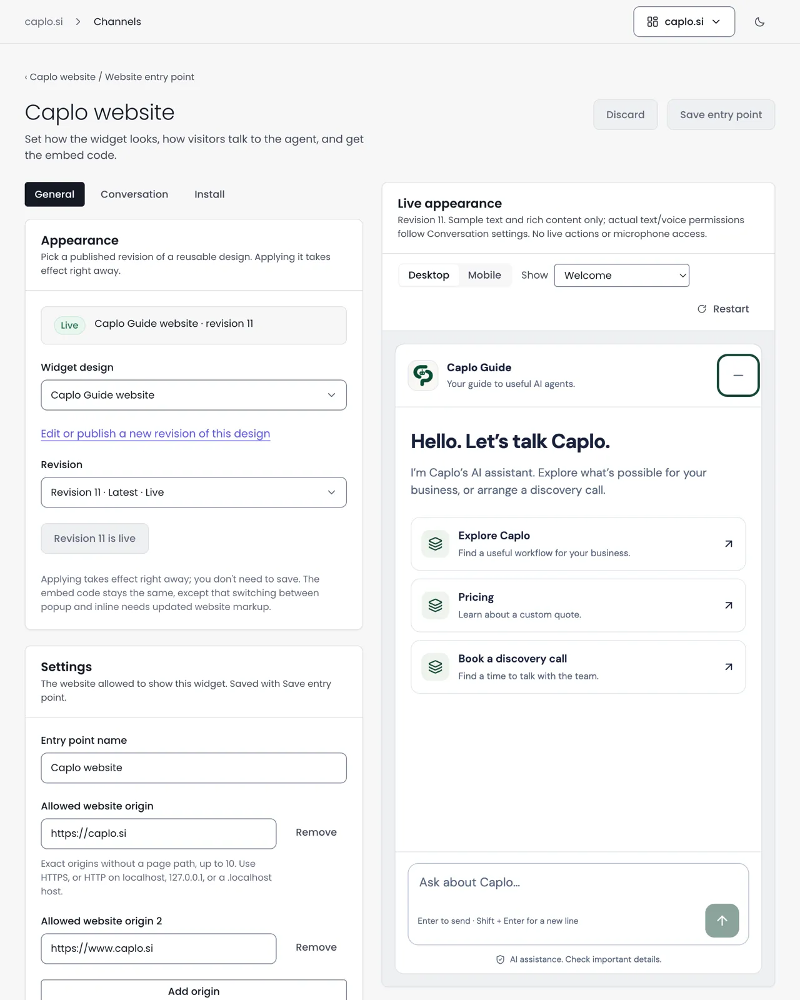
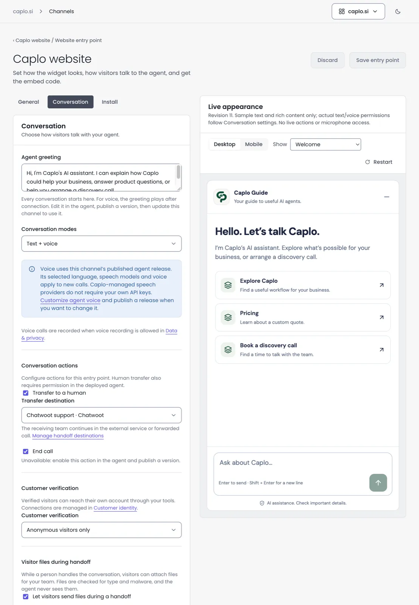

# Website widget settings

> Configure a website entry point's allowed origins, text and voice modes, customer verification and visitor file uploads.

Entry point settings decide where the widget may run and how visitors talk to the agent. They are separate from the [widget design](/channels/website-widget/design/), which only controls appearance.

To open them, go to **Channels**, open the website channel and select **Configure & install**. Settings are on the **General** and **Conversation** tabs. Select **Save entry point** to apply your changes; **Discard** drops them. Saving keeps the same widget ID, so your embed code does not change.

You need the Owner, Admin or Builder role to change these settings.

## General

| Setting                             | What it does                                                                                                                                                                                                                           |
| ----------------------------------- | -------------------------------------------------------------------------------------------------------------------------------------------------------------------------------------------------------------------------------------- |
| **Entry point name**                | Shown in the console only.                                                                                                                                                                                                             |
| **Allowed website origin**          | The exact origins that may show the widget, up to 10. Use HTTPS, or HTTP on `localhost`, `127.0.0.1` or a `.localhost` host. Select **Add origin** for more. See [Allowed origins](/channels/website-widget/install/#allowed-origins). |
| **Enable this website entry point** | Turn off to stop the widget accepting new conversations without deleting the channel.                                                                                                                                                  |
| **Remove entry point**              | Deletes this website channel and its installation. The agent and the widget design are kept.                                                                                                                                           |

The **Appearance** card on the same tab is where you apply a published design revision. Applying takes effect immediately and is not part of **Save entry point**.

## Text and voice

The widget supports text chat and, optionally, voice conversations in the browser.

Voice is off for a new website channel unless you selected **Allow voice conversations** when creating it. To turn it on later:

1. On the channel page, select **Edit channel**.

2. Select **Allow website voice**, then **Save changes**.

3. In the entry point’s **Conversation** tab, set **Conversation modes** to **Text + voice** and select **Save entry point**.

| Conversation mode | Visitors can                                                                                                        |
| ----------------- | ------------------------------------------------------------------------------------------------------------------- |
| **Text only**     | Chat by text.                                                                                                       |
| **Text + voice**  | Chat by text and start a voice conversation from the widget. The browser asks for microphone access the first time. |

Turning **Allow website voice** off switches every website entry point of the channel back to text only.

### Voice engine and turn-taking

A website voice conversation uses the voice settings of the agent release the channel serves: voice language, speech recognition model, voice, optional realtime model, and timing such as **Start replies early**. If the agent has no voice settings, Caplo uses its default English speech recognition and voice, and no setup is needed.

You change these on the agent, under **Advanced settings** then **Voice** in its configuration, and they reach the website after you publish a release and update the channel. See [Voice and speech](/providers/voice-and-speech/).

## Conversation actions

**Conversation actions** lists the actions this entry point allows, such as **Transfer to a human**. An action is available only when the agent release also allows it. For a transfer, choose the **Transfer destination** from your handoff destinations. See [Handoff and end actions](/agents/handoff-and-end-actions/).

## Customer verification

Customer verification lets visitors prove who they are, so the agent’s tools can act on their own account. You set up the verification methods themselves as connections under **Settings** then **Customer identity**: **Host sign-in** (your website’s backend signs a short assertion for a visitor it already knows), **Provider sign-in** (your OpenID Connect provider in a popup) or **Verification code** (a one-time code sent to the visitor’s email or phone on file). On the entry point you choose which of them this website offers.

| **Customer verification**                | Behavior                                                              |
| ---------------------------------------- | --------------------------------------------------------------------- |
| **Anonymous visitors only**              | No verification is offered.                                           |
| **Visitors may verify who they are**     | Visitors can chat anonymously and verify when they or a tool need it. |
| **Visitors must verify before chatting** | Visitors verify before the agent answers.                             |

When verification is allowed, select **Choose sign-in methods and consent for this channel** to set:

* **Sign-in methods**: up to 4 connections, in the order the widget offers them, each with an optional button label. Host sign-in (your own page passing a signed token) runs on its own when your page registers a token provider with the [JavaScript API](/channels/website-widget/javascript-api/#sign-visitors-in-from-your-page).
* **Consent mode**: **Ask for agreement before the first verification**, or **Show a notice after verification**. Host sign-in only runs automatically with the notice mode.
* **Consent version** and **Consent text**: the text visitors agree to, in English and any translations you add. Change the version whenever the text changes; visitors agree to a specific version.
* **Previous conversation**: **Never show earlier conversations**, or **Show the most recent one after verification**.

If the agent’s tools declare verified operations, **Verified tool operations** lets you raise the verification level an operation needs, require recent authentication, and send your API a customer context token. See [Customer-aware tools](/tools/customer-aware-tools/).

Note

Verification changes what tools can do for a visitor. Test a verified flow end to end on a test channel before you require it on your production website.

## Visitor files during handoff

While a person from your team handles the conversation, visitors can attach files for them. The agent never sees these files, and each file is checked for type and malware.

Select **Let visitors send files during a handoff**, then choose:

* **Accepted files**: **Images (JPEG, PNG, GIF, WebP)** and **PDF documents**. Both are selected by default.
* **Largest file**: 1 MB, 5 MB (the default) or 10 MB.

## Related

* [Install the website widget](/channels/website-widget/install/)
* [JavaScript API](/channels/website-widget/javascript-api/)
* [Conversations and handoff](/concepts/conversations-and-handoff/)
