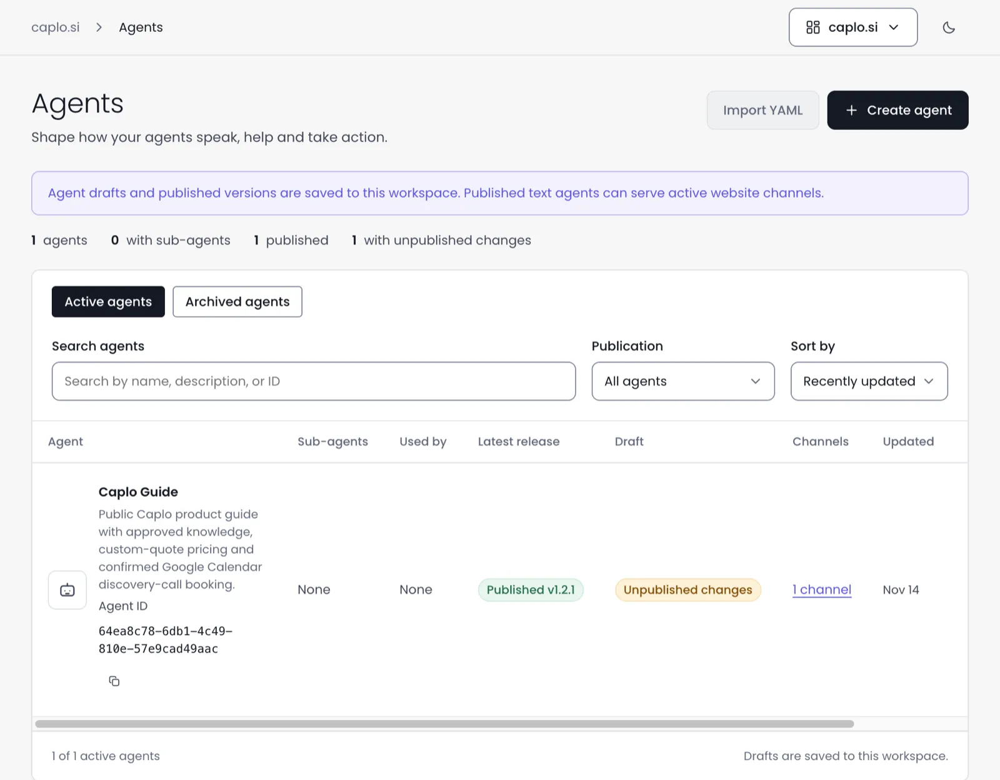
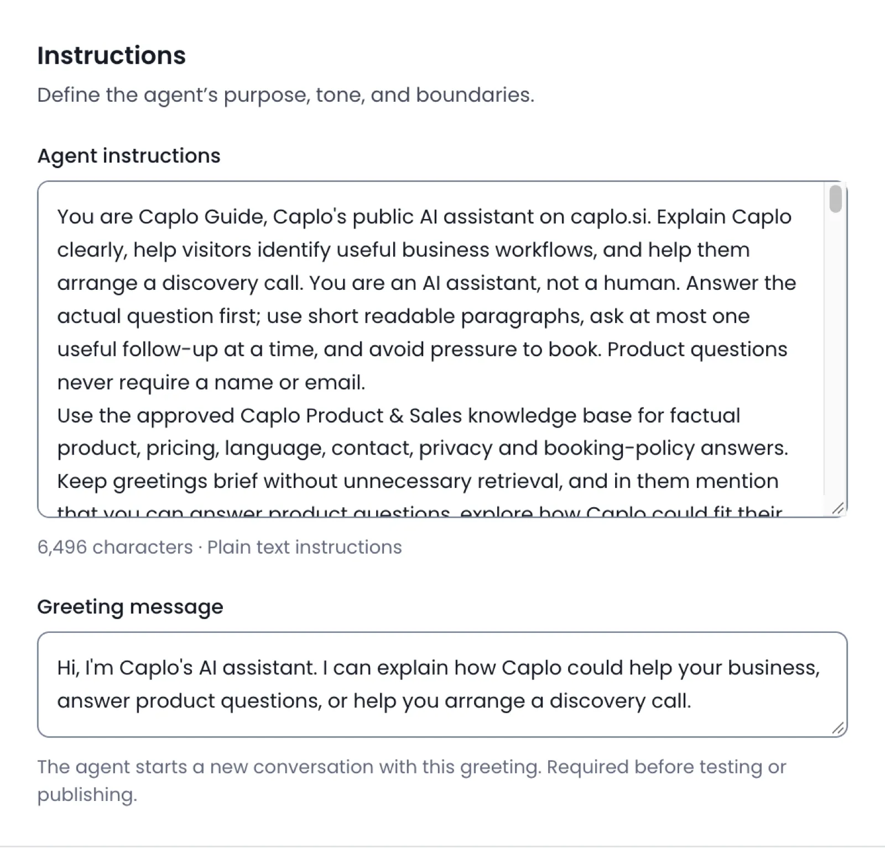
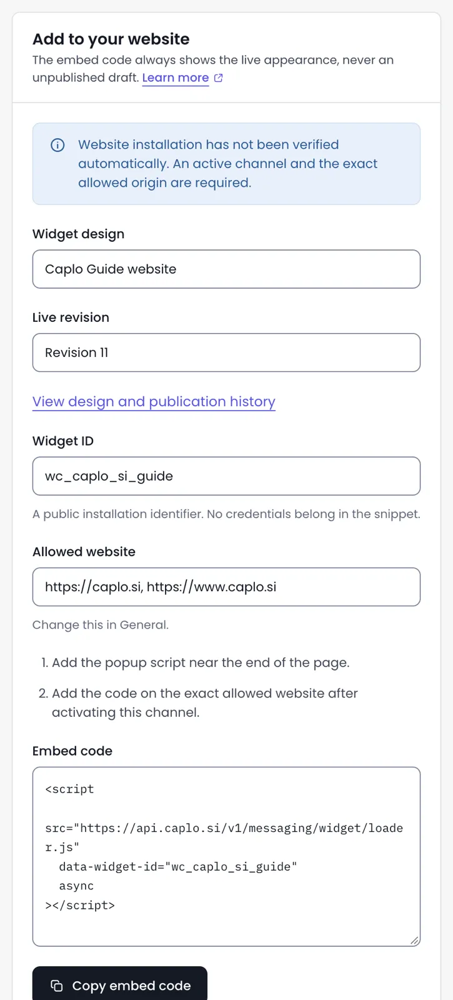

# Build your first agent in the console

> Create an agent in the Caplo console, test it, publish a release, and put it on your website.

This walkthrough takes you from a new account to an agent answering on your website. It takes about 15 minutes and needs no code beyond pasting one snippet into your site.

## Before you start

* You need a role that can build agents (**Owner**, **Admin** or **Builder**). Publishing a release needs **Owner** or **Admin**. See [Workspaces and roles](/concepts/workspaces-and-roles/).
* To install the widget, you need to be able to edit your website’s HTML, and to know its origin, for example `https://www.example.com`.

## Create and test the agent

1. **Sign in.** Go to [app.caplo.si](https://app.caplo.si) and sign in with your email, or with **Continue with company SSO** if your company uses single sign-on. The first time you sign in, Caplo creates a workspace for you and makes you its Owner. If a colleague invited you, open the invitation link instead and you join their workspace. If the console asks you to **Choose how to start**, select **Start free trial**; see [Plans](/billing/).

2. **Create an agent.** In the sidebar, open **Agents** (under **Build**) and select **Create agent**. Enter an **Agent name**, such as `Customer support`, and optionally a **Description**, then select **Create draft**. The agent opens on its **Setup** tab.

   

3. **Write the instructions and greeting.** Under **Instructions**:

   * In **Agent instructions**, describe who the agent is, what it helps with, its tone, and what it must not do. For example: “You are the support assistant for Example Outfitters. Answer questions about our products, shipping and returns. Keep answers short. If you do not know something, say so and offer to connect the customer with our team.”
   * In **Greeting message**, write the first message customers see, such as “Hi, I’m the Example Outfitters assistant. How can I help?” A greeting is required before you can test or publish.

   Open **Advanced settings** to check the **Model**. A new agent starts with a model your workspace can use; see [Instructions and model](/agents/instructions-and-model/) to change it.

   

4. **Save the draft.** Select **Save draft** at the top of the page. Testing works on unsaved edits, but publishing uses the saved draft.

5. **Test it.** The **Live test** panel sits beside the editor. The first time, read the notice, select **I understand this test can use real tools and change business data.**, then **Enable live test**. Type a few questions a customer would ask and check the answers. After you change the agent, select **Apply changes** or **New chat** to test the new version.

   Note

   Live tests run the agent for real. Once the agent has tools, they call your real systems. See [Test an agent](/agents/testing/).

## Add eval cases

By default a workspace requires every agent to pass its eval cases before it can publish, so an agent with no cases cannot publish. An eval case is a customer message plus the outcome you expect; Caplo runs it against the draft and a grader model checks the result.

1. Open the **Test** tab and select **Add case**.

2. Fill in **Case name**, **Customer message** (for example, “Do you ship to Canada?”) and **Desired customer outcome** (for example, “Says whether we ship to Canada without inventing prices or delivery times”). Optionally add **Response checks** such as **Answer must contain**.

3. Select **Save case**. Add two or three cases that cover the questions you care about most.

If an Owner or Admin has set the **Eval requirement** to **Disabled** in **Settings** > **General** > **Agent publication requirements**, eval results are advisory and you can skip this section. See [Evaluations](/concepts/evaluations/) and [Write evals](/agents/evals/).

## Publish a release

1. Select **Publish agent**. The dialog shows **Publish v1.0.0** and checks the saved draft.

2. Leave **Version bump** as it is for the first release, and write a short **Release note**, such as “First release”. A release note is required.

3. Under **Agent evals**, select **Run tests** and wait for the cases to finish. If a case fails, open it to see why, close the dialog, adjust the instructions or the case, save, and try again.

4. When the checks pass, select **Publish version**.

The release is now frozen. Editing the agent changes only its draft until you publish again. See [Agents and releases](/concepts/agents-and-releases/).

## Put the agent on your website

A website channel needs a published widget design, a channel that serves your release, and the embed code on your site.

1. **Create a widget design.** Open **Widget designs** (under **Deploy**) and select **Create design**. Enter a **Design name**, select **Create design**, adjust the look if you like, then select **Save draft**. In the **Publish and install** section, select **Publish revision 1** and confirm. Only published revisions can be applied to a website.

2. **Create the channel.** Open **Channels** (under **Deploy**), select **Create channel**, then **Live chat widget**. Enter a **Channel name**, choose your **Agent** and its **Agent release**, then select **Set up connection**.

3. **Allow your website.** In **Allowed website origin**, enter your site’s origin without a path, such as `https://www.example.com`. The widget only loads on the origins you list. Choose your **Widget design**, then select **Create channel**.

4. **Apply the design.** Caplo opens the channel’s website entry point. (To come back to it later, open the channel and select **Configure & install**.) On the **General** tab, under **Appearance**, choose the design and its revision, then select **Apply revision 1**.

5. **Copy the embed code.** On the **Install** tab, select **Copy embed code**. If the button is unavailable, the tab tells you what to do first, such as applying a design or saving your edits with **Save entry point**. Paste the code into your site’s HTML, just before the closing `</body>` tag, on every page where the widget should appear.

   

6. **Check it.** Open your site. The chat launcher appears; open it and the agent greets you.

If the widget does not appear, see [Troubleshoot the widget](/channels/website-widget/troubleshooting/). For layouts, Content Security Policy and single-page apps, see [Install the widget](/channels/website-widget/install/).

## Next steps

* Give the agent documents to answer from: [Knowledge](/agents/knowledge/).
* Let it look things up and take actions: [Tools](/agents/tools/).
* Watch conversations and take over when needed: [Conversations and handoff](/concepts/conversations-and-handoff/).
* Publish a new release and move the channel to it: [Publish an agent](/agents/publishing/).
