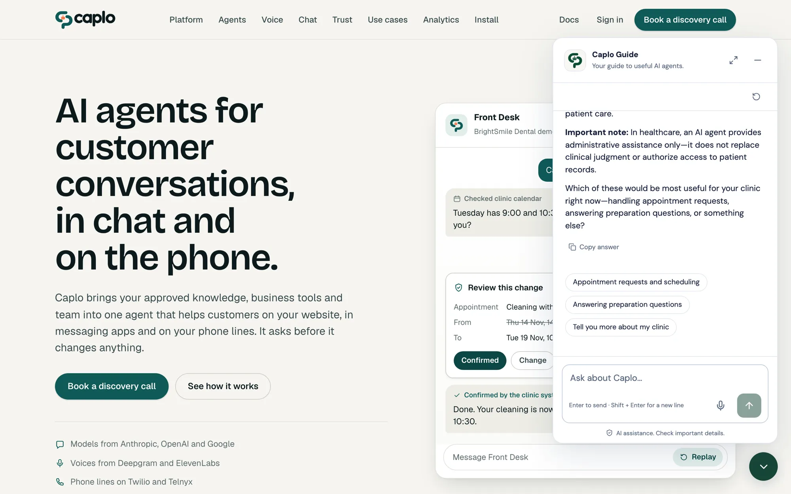
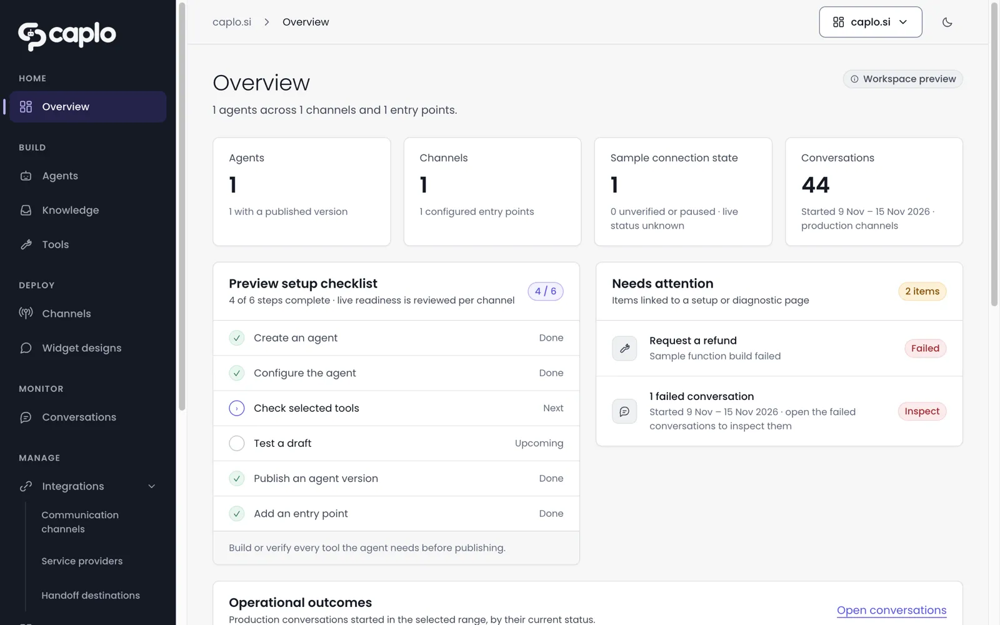

# What is Caplo

> What Caplo is for, the building blocks you work with, and which tool to use for each job.

Caplo is a platform for building AI agents that talk to your customers. An agent answers from documents you approve, looks things up and takes actions through tools you connect, and serves customers on your website, in WhatsApp, Messenger and Instagram, and over the phone. You build and test agents in a private draft, publish them as fixed releases, and decide which release each channel serves.

## Building blocks

| Block          | What it is                                                                                                                                                          |
| -------------- | ------------------------------------------------------------------------------------------------------------------------------------------------------------------- |
| Workspace      | Your team’s space in Caplo. It holds every agent, tool, knowledge base, channel and conversation, plus members, roles, provider keys and billing.                   |
| Agent          | An assistant with instructions, a greeting, a model, and optionally knowledge bases, tools and sub-agents.                                                          |
| Draft          | The editable version of an agent. You change and test the draft; customers never talk to it.                                                                        |
| Release        | A frozen, numbered copy of a draft. Publishing creates a release and pins the exact tool versions it uses.                                                          |
| Tool package   | Code that gives agents tools, such as looking up an order or booking an appointment. You can also connect a remote MCP server. Each published version is immutable. |
| Knowledge base | Files you upload that agents search to answer questions. Each file is used as soon as it is live.                                                                   |
| Channel        | Where customers reach an agent: a website widget, a WhatsApp number, a Messenger page, an Instagram account or a phone number. A channel serves one agent release.  |
| Conversation   | One customer’s chat or call on a channel. It keeps the release it started with, and your team can read it and take over.                                            |

## How they fit together

1. You create an agent in a workspace and write its instructions and greeting.
2. You attach knowledge bases and tools, and link other agents as sub-agents if one agent should delegate to specialists.
3. You test the draft in a private test chat and add eval cases: example customer messages with the outcome you expect.
4. You publish. Caplo checks the draft, runs the eval cases, pins every tool version, and creates an immutable release.
5. You point a channel at that release. New conversations on the channel use it; conversations already in progress keep the release they started with.
6. You watch conversations in the console, step in when a person is needed, and publish new releases as you improve the agent.

Read [Agents and releases](/concepts/agents-and-releases/) for why releases are frozen, and the other [Concepts](/concepts/workspaces-and-roles/) pages for each block in more depth.

## Console, CLI and Tool Studio

You can do most work in more than one place. Pick the one that suits the job.

| Tool        | Where                                      | Use it to                                                                                                                                                                                        |
| ----------- | ------------------------------------------ | ------------------------------------------------------------------------------------------------------------------------------------------------------------------------------------------------ |
| Console     | [app.caplo.si](https://app.caplo.si)       | Create and test agents, upload knowledge, design and install the website widget, connect channels, read conversations and take over, invite members, manage provider keys, usage and settings.   |
| `caplo` CLI | Your terminal and CI                       | Keep agents and tool packages as files in your own repository, then validate, push, chat with, evaluate and publish them. Also deploy channels to new releases and sync knowledge from a folder. |
| Tool Studio | [studio.caplo.si](https://studio.caplo.si) | Write, build, test and publish tool packages in a browser-based code editor, without installing anything.                                                                                        |

The three share one workspace. An agent pushed from the CLI shows up in the console, and a tool published from Tool Studio can be attached to an agent in either.

## Where to go next

* [Quickstart in the console](/get-started/quickstart-console/): create, test and publish an agent, then add it to a website.
* [Quickstart with the CLI](/get-started/quickstart-cli/): scaffold a multi-agent project with tools and publish it from your terminal.
* [Add an agent to your website](/get-started/add-to-your-website/): the short path from a published agent to a working widget.
* [Write your first tool](/tools/first-tool/): give an agent access to your own systems.
