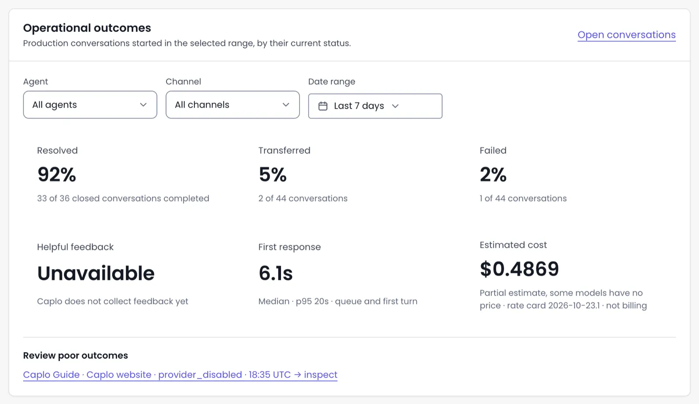

# Monitor agents and read analytics

> See how production conversations turn out, trace what an agent did on each turn, investigate a bad answer, and tell live figures from preview content.

Caplo records what your agents do on every turn: which models and tools they called, how long each step took, what failed and what it cost. The console shows this in three places:

| Where                                  | What it shows                                                                      | Data           |
| -------------------------------------- | ---------------------------------------------------------------------------------- | -------------- |
| **Overview**, **Operational outcomes** | Outcome rates, first response time and estimated cost for production conversations | Live           |
| **Conversations**                      | Each production conversation with its transcript, tool calls and turn activity     | Live           |
| **Monitor**, beside a live test        | Every step of a test chat as it happens, as a timeline, waterfall or event log     | Your test only |

Reading outcomes and conversations needs a role that can read conversations: Owner, Admin, Builder, Supervisor, Auditor or Viewer. For money spent, use [Usage and billing](/usage/) instead; the cost figures here are estimates.

## Operational outcomes

Open **Overview**. The **Operational outcomes** card covers production conversations started in the selected range, by their current status. Filter it by **Agent**, **Channel** and **Date range**; days follow the workspace time zone set in [General settings](/admin/workspace-settings/).

| Figure             | Meaning                                                                                                                                 |
| ------------------ | --------------------------------------------------------------------------------------------------------------------------------------- |
| **Resolved**       | Completed conversations as a share of the closed ones.                                                                                  |
| **Transferred**    | Conversations handed to a person, as a share of all.                                                                                    |
| **Failed**         | Conversations whose last turn failed, as a share of all.                                                                                |
| **First response** | The median time to the first reply, with the 95th percentile. It includes time waiting in the queue and the whole first turn.           |
| **Estimated cost** | The estimated model cost of the agents’ turns in the range. It is not split by channel, so it shows a dash while a channel is selected. |

**Review poor outcomes** links to the latest failed conversations, with the agent, channel and error code of each. **Needs attention** on the same page also counts failed conversations in the range and links to them.

The **Conversations** page adds live counts at the top: conversations in the range, **Live now**, **Needs attention** and the median **First response**. See [Work in the Conversations inbox](/operate/conversations-inbox/).

## What is live and what is preview

Only some of the **Overview** page reads live traffic:

* Live: the **Conversations** tile, **Operational outcomes**, **Review poor outcomes** and the failed conversations under **Needs attention**.
* Built from your configuration, not from traffic: the **Agents** and **Channels** tiles, the **Preview setup checklist** and **Channel readiness**. Badges such as **Sample connection state**, **Provider unverified** and **Live health unavailable** mark figures that do not come from live provider or health checks.
* **Helpful feedback** under **Operational outcomes** shows **Unavailable**. To read ratings, open the rated conversations in **Conversations**.

**Estimated cost** figures, on **Overview** and on each conversation, come from Caplo’s rate card for model calls. They can be marked partial when a model has no price, and they are not what you are charged. What you are charged is on **Plan & billing**; see [How your bill works](/billing/how-billing-works/).

Outcomes and conversation lists are built from trace data, so they reach back only as far as the workspace’s **Trace retention**. See [Data and privacy](/operate/data-and-privacy/).

## Trace a test chat with Monitor

In the agent builder, open **Live test** and select **Expand** to see the chat and **Monitor** side by side. Monitor shows each turn of the test as it runs, with its latency, model calls and tokens.

| View          | Shows                                                                                                                                                    |
| ------------- | -------------------------------------------------------------------------------------------------------------------------------------------------------- |
| **Timeline**  | Each turn’s steps in order: model calls, routing, tools, confirmations, sub-agents, knowledge searches and policy checks. Select a step for its details. |
| **Waterfall** | Each finished turn as nested timed spans, to see where the time went.                                                                                    |
| **Log**       | The raw execution events.                                                                                                                                |

Filter by agent, by step type, or with **Errors only**. A step’s details include, depending on its kind:

* For a model call: the model, provider, which key paid for it, tokens in and out, and the stop reason.
* For a tool: the package and version, whether it reads or changes data, the attempt, queue and run time, cold start and confirmation.
* For a sub-agent, a knowledge search or a policy check: its result, the sources and chunks found, or the limit used.
* For a failure: the error code, the failing component and whether it can be retried.

**Copy trace ID** and **Copy step ID** give identifiers to quote to [support](/resources/support/). **Export** downloads the test’s events as JSON. See [Test an agent](/agents/testing/).

## Investigate a bad answer

1. **Find the conversation.** Start from **Review poor outcomes**, a customer’s rating, a conversation ID a customer gave you, or the **Conversations** filters: **Agent** and **Version**, **Has errors**, or **Status** **Failed**.
2. **Read the transcript.** Note the exact customer message that went wrong and the release in the header.
3. **Open the tool calls.** Under the agent’s reply, select **Show tool calls**. Check each call’s outcome and reason, the arguments the agent sent, and **Result the model read**. A wrong answer often comes from a tool that failed, returned the wrong data, or was never called.
4. **Check the turn.** The **Activity** tab shows the turn’s status, latency, sub-agent calls, knowledge searches and any error code with its meaning.
5. **Reproduce it.** In **Live test**, choose the **Published** release the customer used, send the same message, and follow it in **Monitor**. Tool packages have their own invocation logs; see [Versions and logs](/tools/versions-and-logs/).
6. **Fix it and keep it fixed.** Change the instructions, knowledge or tool, add the conversation as an [eval case](/agents/evals/), then [publish](/agents/publishing/) and deploy the new release.

Note

Tool call details are visible to Owners, Admins and Supervisors. Builders, Auditors and Viewers see that a turn called tools, but not the arguments or results.

## Related

* [Work in the Conversations inbox](/operate/conversations-inbox/)
* [Usage and charges pages](/usage/usage-and-statements/)
* [Write and run evals](/agents/evals/)
