# Show results to customers

> Use caplo.yaml presentation to show progress, confirmation cards, receipts, result layouts, maps, pages and files, and let read tools ask the visitor for missing details.

By default a tool’s result goes only to the agent, which answers in text. A `presentation` in the tool’s `caplo.yaml` policy also shows the customer selected parts of it: a confirmation card for a write, a receipt afterwards, a list of products as cards, a delivery timeline, nearby stores on a map, a checkout page, a PDF invoice. The agent’s text reply goes out as usual alongside.

Presentation is display metadata only. It selects and labels properties of the tool’s schemas; nothing else of the arguments or result is shown, and it grants no permission to run anything. The build checks every path and role against your input and output schemas and fails with a clear message if something does not fit.

Result layouts, confirmation cards and forms appear in the [website widget](/channels/website-widget/install/). Where a channel cannot show them, the customer gets the agent’s text reply. Design your tools so the text result is enough on its own.

Note

Paths are JSON pointers to one direct property: `/orderId`, `/products`. Labels and titles are plain text up to 80 characters. Every `presentation` needs `schemaVersion: 1`, a `title` and at least one entry in `fields`.

## Show progress

`progress` shows a status line while the tool runs. It is fixed text: it cannot include values from the call.

```plaintext
tools:
  - name: search_products
    effect: read
    timeoutSeconds: 10
    progress:
      label: Searching the catalog
      spoken: Let me look that up.
```

* `label`: shown in the widget. 3 to 40 characters, no trailing punctuation, no links.
* `spoken`: optional, said in voice conversations. One sentence of 3 to 90 characters ending with a full stop.

## Confirmation and receipt

For a [write tool](/tools/write-tools/), `fields` chooses which input arguments the review card shows, and `receipt` chooses which properties of the result to show once the write succeeds.

```plaintext
tools:
  - name: cancel_order
    effect: write
    timeoutSeconds: 15
    confirmation: required
    presentation:
      schemaVersion: 1
      title: Cancel order
      fields:
        - path: /orderId
          label: Order
          display: plain
        - path: /reason
          label: Reason
          display: plain
          editable: true
          input: select
          options:
            - value: changed_mind
              label: Changed my mind
            - value: ordered_by_mistake
              label: Ordered by mistake
            - value: found_cheaper
              label: Found it cheaper
        - path: /note
          label: Note
          display: plain
          editable: true
          input: text
      receipt:
        fields:
          - path: /orderId
            label: Order
            display: plain
          - path: /status
            label: Status
            display: plain
```

* Up to 12 fields, each a direct property of the input schema with one primitive type (string, number, integer or boolean).
* `display: last4` shows only the last four characters of a string, for example a card or account number. A masked field cannot be editable.
* `editable: true` lets the customer change a string argument before confirming. With `input: text`, the property needs a `maxLength` of 1 to 1000. With `input: select`, the property needs a string `enum` of 1 to 20 values, and `options` must label every value exactly once.
* `writeOnly` properties, `format: password` properties, names that match a declared secret and the [subject selector](/tools/customer-aware-tools/) cannot be shown. `readOnly` properties can be shown but not edited.
* On a voice call, the title and each field are read aloud as “Label: value”. A `last4` value is read as “ending in” its last four characters, and an absent value as “not provided”.
* `receipt.fields` (up to 12) come from the structured result, so the tool needs an `outputSchema`. A receipt only displays values; it never decides whether the write succeeded.

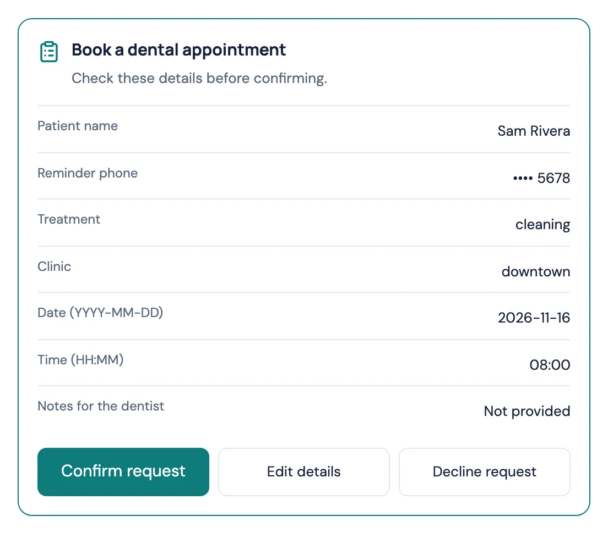

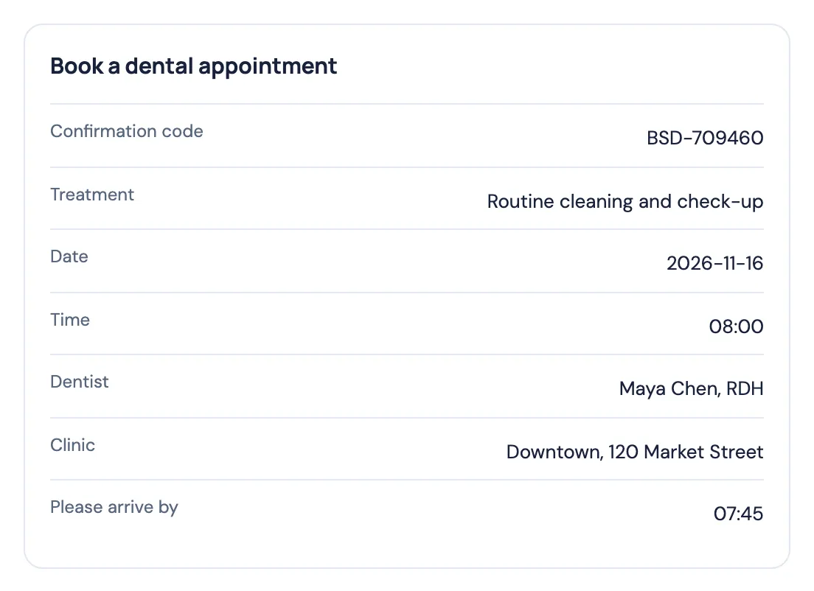

## Show a result

`result` shows items from the tool’s structured result with the agent’s reply. The tool needs an `outputSchema`, and `path` names a direct array property of it (or, for a detail or a page, an object).

| Layout          | Shows                                                                  | Columns                                                                          | Item actions      |
| --------------- | ---------------------------------------------------------------------- | -------------------------------------------------------------------------------- | ----------------- |
| `list`, `table` | Up to 20 items                                                         | Up to 6, no roles                                                                | None              |
| `cards`         | Up to 20 items as cards                                                | Up to 6; `title` role required                                                   | Up to 2           |
| `choices`       | Up to 10 items the customer taps to reply                              | Up to 6; `title` role required                                                   | Exactly 1 `reply` |
| `detail`        | One object: the result itself, or the object property `path` names     | Up to 12; `title` role required                                                  | Up to 2           |
| `comparison`    | Up to 4 items side by side                                             | Up to 12; `title` role required; columns without a role become rows              | Up to 2           |
| `timeline`      | Up to 12 steps                                                         | Up to 4, every column needs a role; `title` and `status` required                | None              |
| `map`           | Up to 20 places on a map, with a numbered list                         | Up to 12, at most 6 without a role; `title`, `latitude` and `longitude` required | Up to 2           |
| `page`          | One object as a page the customer opens over the chat; read tools only | Up to 3, every column needs a role; `title` and `link` required                  | None              |

Columns are direct primitive properties of an item. A result that does not fit the layout’s bounds, for example 25 items for `cards`, shows no component; the agent’s reply still goes out. Return at most as many items as the layout shows.

### Cards

```plaintext
    presentation:
      schemaVersion: 1
      title: Product search
      fields:
        - path: /query
          label: Search
          display: plain
      result:
        path: /products
        layout: cards
        title: Matching products
        columns:
          - path: /imageUrl
            label: Photo
            display: plain
            role: image
          - path: /name
            label: Product
            display: plain
            role: title
          - path: /price
            label: Price
            display: plain
            role: money
            currency:
              path: /currency
          - path: /url
            label: Details
            display: plain
            role: link
        actions:
          - kind: reply
            label: Add to cart
            template: Add {name} to my cart
          - kind: link
            label: View
            path: /url
```

Here the output schema has a `products` array whose items have `imageUrl`, `name`, `price`, `currency` and `url`.

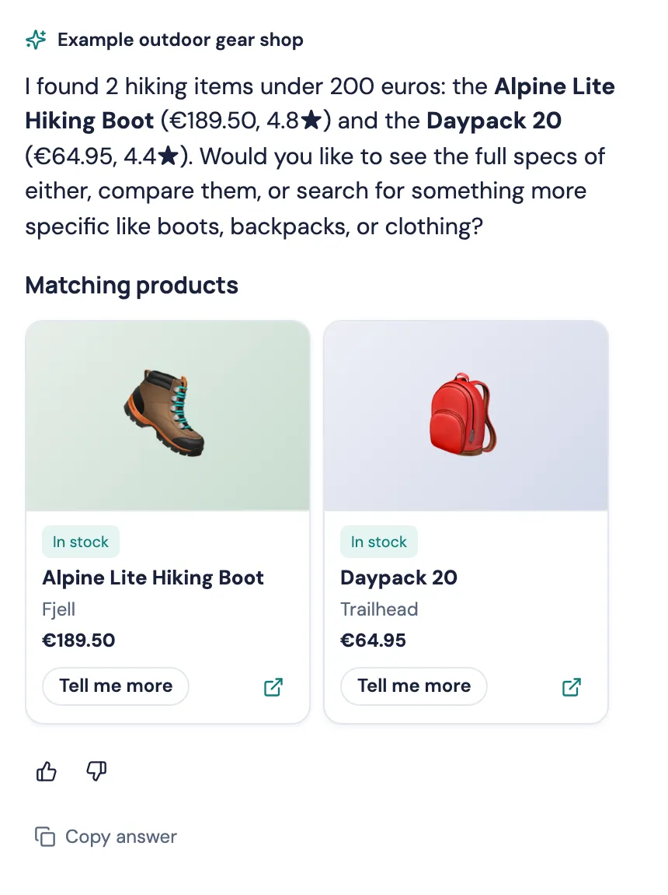

### Column roles

| Role                      | Property type                             | Layouts                                                                       | Shows                                                                                                                        |
| ------------------------- | ----------------------------------------- | ----------------------------------------------------------------------------- | ---------------------------------------------------------------------------------------------------------------------------- |
| `title`                   | string                                    | all with roles                                                                | The item’s heading.                                                                                                          |
| `subtitle`, `description` | string                                    | cards, detail, comparison, map; `description` also choices, timeline and page | Secondary text.                                                                                                              |
| `image`                   | string                                    | cards, detail, comparison, map                                                | An image. The value must be an `https` URL.                                                                                  |
| `link`                    | string                                    | cards, detail, comparison, map, page                                          | A link. The value must be an `https` URL; for a page, on one of its origins.                                                 |
| `money`                   | number or integer                         | cards, detail, comparison, map                                                | An amount, with `currency` set to a fixed `code` such as `USD` or the `path` of a string property holding the ISO 4217 code. |
| `badge`                   | string, number or integer                 | cards, detail, comparison, map                                                | A short highlighted value, such as a status.                                                                                 |
| `status`                  | string with an `enum`                     | timeline                                                                      | The step’s state. `statuses` maps every enum value to `done`, `current` or `upcoming`.                                       |
| `time`                    | string with `format: date` or `date-time` | timeline                                                                      | When the step happened or is due.                                                                                            |
| `latitude`, `longitude`   | number                                    | map                                                                           | Where the place is, in degrees.                                                                                              |
| `address`                 | string                                    | map                                                                           | The place’s address, under its title.                                                                                        |

Each role can be used by one column only, and a column with a role uses `display: plain`. Values that are not `https` URLs are left off the card.

### Actions

* `reply` sends a message as the customer, built from `template`. `{name}` inserts the item’s value of the listed column `name`; image, link, status, time, latitude and longitude columns cannot be inserted.
* `link` opens the URL in the listed string column `path`.
* Labels are up to 20 characters. Neither kind calls a tool; the agent handles the reply like any message.

### Choices

```plaintext
      result:
        path: /slots
        layout: choices
        title: Pick a time
        columns:
          - path: /label
            label: Time
            display: plain
            role: title
        actions:
          - kind: reply
            label: Book
            template: Book the {label} slot
```

Each choice sends its filled-in reply. Columns without a role must appear in the template.

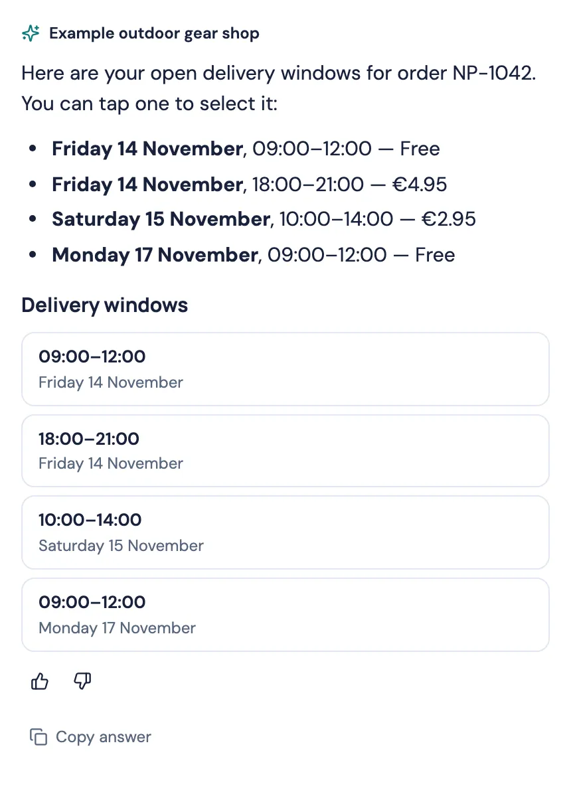

### Detail

```plaintext
      result:
        layout: detail
        title: Your order
        columns:
          - path: /orderId
            label: Order
            display: plain
            role: title
          - path: /status
            label: Status
            display: plain
            role: badge
          - path: /total
            label: Total
            display: plain
            role: money
            currency:
              path: /currency
          - path: /trackingUrl
            label: Track parcel
            display: plain
            role: link
```

Without `path`, a detail shows the result object itself.

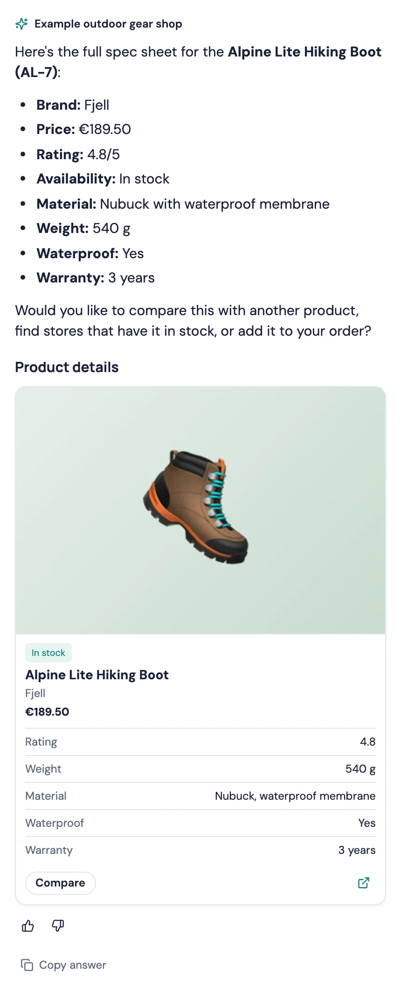

### Comparison

```plaintext
      result:
        path: /plans
        layout: comparison
        title: Compare plans
        columns:
          - path: /name
            label: Plan
            display: plain
            role: title
          - path: /monthly
            label: Per month
            display: plain
            role: money
            currency:
              code: USD
          - path: /data
            label: Data
            display: plain
          - path: /contract
            label: Contract
            display: plain
```

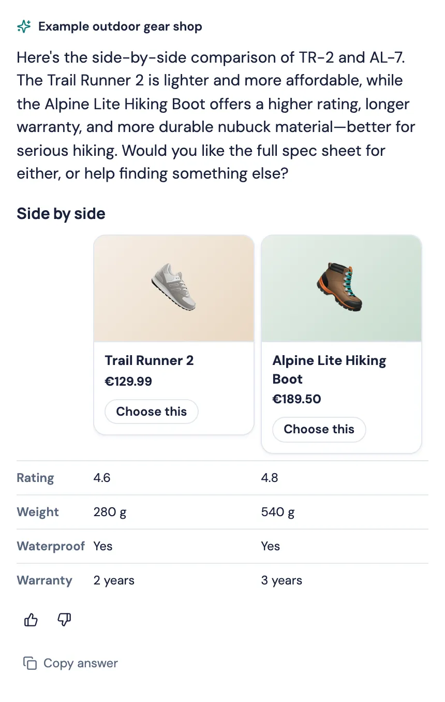

### Timeline

```plaintext
      result:
        path: /steps
        layout: timeline
        title: Delivery progress
        columns:
          - path: /name
            label: Step
            display: plain
            role: title
          - path: /state
            label: State
            display: plain
            role: status
            statuses:
              complete: done
              in_progress: current
              not_started: upcoming
          - path: /at
            label: When
            display: plain
            role: time
```

The `state` property’s schema is `{ "type": "string", "enum": ["complete", "in_progress", "not_started"] }`, and `at` is a string with `format: date-time`.

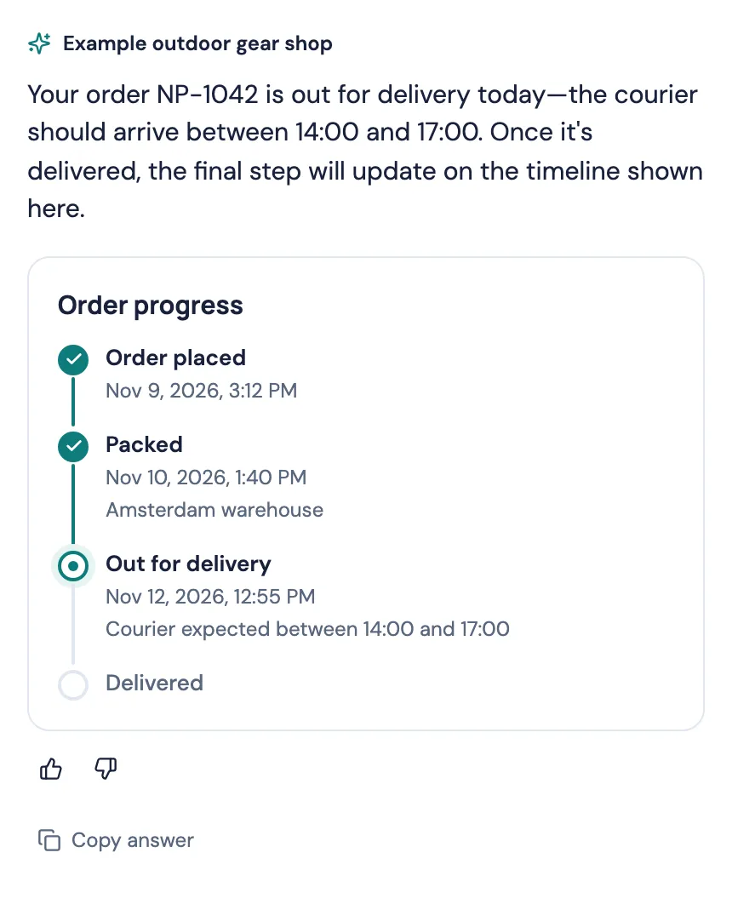

### Map

```plaintext
      result:
        path: /stores
        layout: map
        title: Stores with stock
        columns:
          - path: /name
            label: Store
            display: plain
            role: title
          - path: /address
            label: Address
            display: plain
            role: address
          - path: /lat
            label: Latitude
            display: plain
            role: latitude
          - path: /lng
            label: Longitude
            display: plain
            role: longitude
          - path: /inStock
            label: In stock
            display: plain
          - path: /pickup
            label: Pickup
            display: plain
        actions:
          - kind: reply
            label: Pick up here
            template: I'll pick it up at {name}
```

`lat` and `lng` are numbers in degrees. Each place is numbered on the map and in the list under it, and gets a **View on map** link that opens OpenStreetMap at its coordinates. The list is always shown. If the map cannot be drawn, for example because the host page’s [Content Security Policy](/channels/website-widget/install/) has no `worker-src blob:`, the list appears on its own.

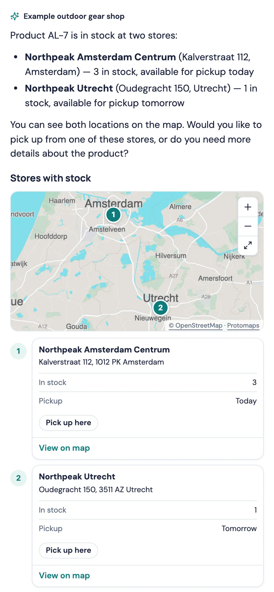

### Page

A page links the customer to a page of your own, such as a checkout, a booking calendar or a signing page, and opens it over the chat. Only read tools can return one.

```plaintext
      result:
        layout: page
        title: Privacy notice
        columns:
          - path: /title
            label: Notice
            display: plain
            role: title
          - path: /summary
            label: About
            display: plain
            role: description
          - path: /url
            label: Privacy notice
            display: plain
            role: link
        page:
          label: Read it here
          display: panel
          origins:
            - https://caplo.si
```

* Without `path`, the page comes from the result object itself; with `path`, from that object property.
* `page.label` is the button text, up to 20 characters.
* `display: panel` opens the page in a sandboxed panel over the chat. `display: tab` opens a new browser tab; use it for pages that refuse to be framed. If the host site’s Content Security Policy blocks the frame, the widget offers a new tab instead.
* `origins` lists 1 to 5 `https` origins without a path. `https://*.example.com` allows any subdomain. A link outside them shows no page.
* The page opens only when the customer taps the button.

When the customer closes the panel, or taps **I’ve finished** after using a tab, the agent receives the message “I closed the *title* page.” or “I finished on the *title* page.”, with the item’s title. The page can close the panel itself:

```plaintext
window.parent.postMessage({ type: "caplo.page", event: "done" }, "*");
```

`event` is `done` or `close`. Only messages from the panel’s own frame, at one of the declared origins, are accepted.

Note

A page never decides an outcome. After it closes, have the agent check the result with a read tool, for example whether the payment went through.

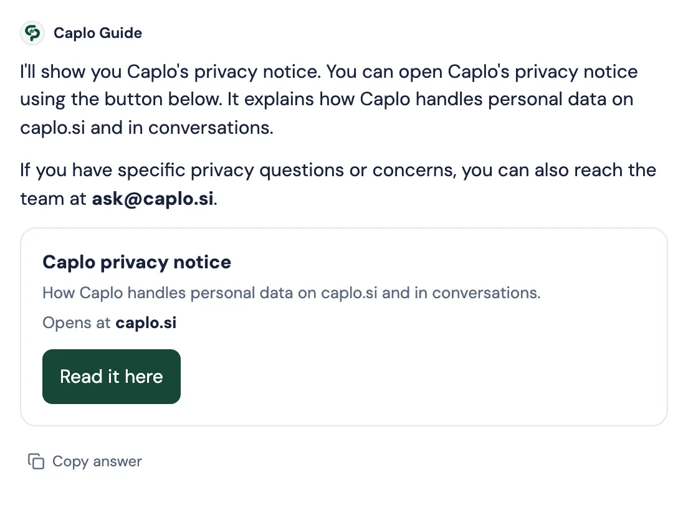

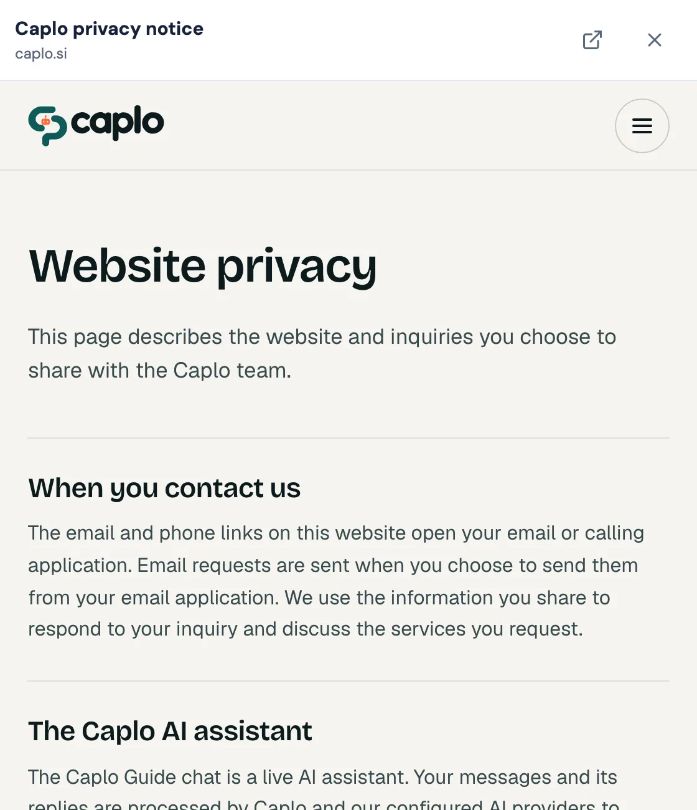

## Return files

A read tool can hand the customer up to three files per call, such as an invoice PDF or a floor plan. Declare the types and the largest size:

```plaintext
tools:
  - name: get_invoice
    effect: read
    timeoutSeconds: 10
    presentation:
      schemaVersion: 1
      title: Invoice
      fields:
        - path: /orderId
          label: Order
          display: plain
      files:
        accept:
          - application/pdf
        maxBytes: 2097152
```

`accept` lists any of `image/jpeg`, `image/png`, `image/gif`, `image/webp` and `application/pdf`. `maxBytes` is 1024 to 10485760 (10 MiB) per file.

Return each file as an MCP embedded resource with base64 content. The last part of `uri` is the file name the customer sees:

```plaintext
return {
  content: [
    { type: "text", text: `Invoice ${invoice.number} for order ${orderId}` },
    { type: "resource", resource: { uri: `file:///${invoice.number}.pdf`, mimeType: "application/pdf", blob: pdf.toString("base64") } },
  ],
};
```

Embedded resources are written with the MCP SDK, so files need an MCP package. Caplo takes the files out of the result before the model sees it, checks that each file’s content matches its type, scans it, and shows it with the reply as a download where the channel can. A file of an undeclared type, over `maxBytes`, or a fourth file fails the call. Where the channel cannot deliver files, such as a phone call, the agent is told the file was not delivered, so also return the essentials as text.

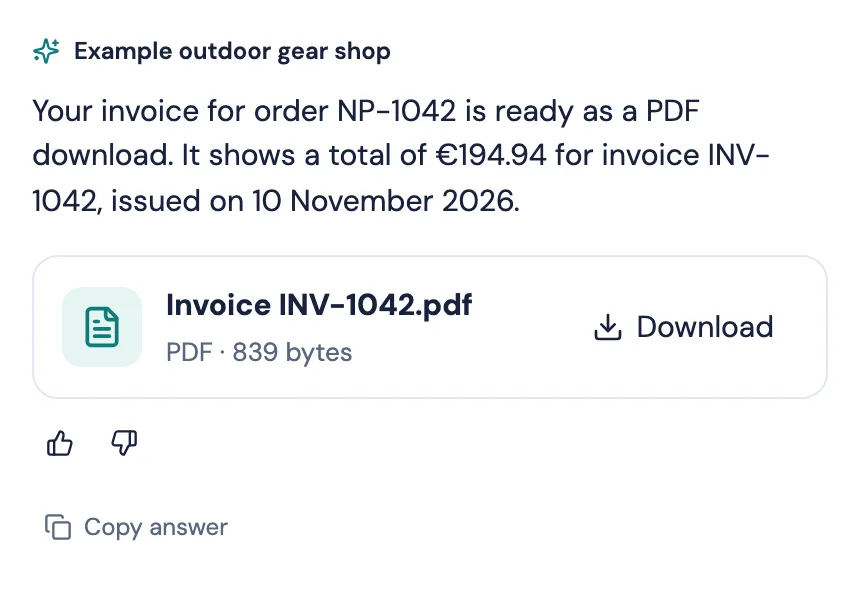

## Ask for missing details

A read tool can ask the visitor for details it needs while it runs, with an MCP form. Declare every field the tool may ask for:

```plaintext
tools:
  - name: find_store
    effect: read
    timeoutSeconds: 10
    elicitation:
      fields:
        - name: city
```

Then ask from the code. In a function package, use `ctx.canElicit` and `ctx.elicit`:

```plaintext
async handler(args, ctx) {
  let city = args.city;
  if (!city) {
    if (!ctx.canElicit) return "Ask the customer which city to search in, then call this tool again with it.";
    const answer = await ctx.elicit({
      message: "Which city should I search in?",
      requestedSchema: { type: "object", properties: { city: { type: "string", title: "City", maxLength: 60 } }, required: ["city"] },
    });
    if (answer.action !== "accept") return "The customer did not choose a city.";
    city = String(answer.content?.city);
  }
  // look up stores in city...
}
```

In an MCP package, check `server.server.getClientCapabilities()?.elicitation` and call `server.server.elicitInput({ message, requestedSchema })`.

* Forms are offered only in website widget text conversations. Elsewhere, such as phone calls and evaluations, `canElicit` is false; return a message that lets the agent ask in the conversation instead.
* The answer is `accept` with `content`, `decline`, or `cancel`.
* When the visitor answers, the tool runs again from the start with the same arguments, and the earlier `elicit` call returns the stored answer. Ask before doing any work, and keep everything before the question safe to repeat.
* Up to 12 declared fields and three questions per call. Fields use the MCP form subset: strings (with `minLength`, `maxLength`, `format` `email`, `uri`, `date` or `date-time`, or an `enum`), numbers, integers, booleans and arrays of enum strings. `pattern` is not supported.
* Write tools cannot ask; they collect input through [editable confirmation fields](#confirmation-and-receipt).

Caution

Never ask for a password, card number, one-time code or other credential. Caplo refuses fields and forms whose names, titles or options name one, and the build rejects such field names.

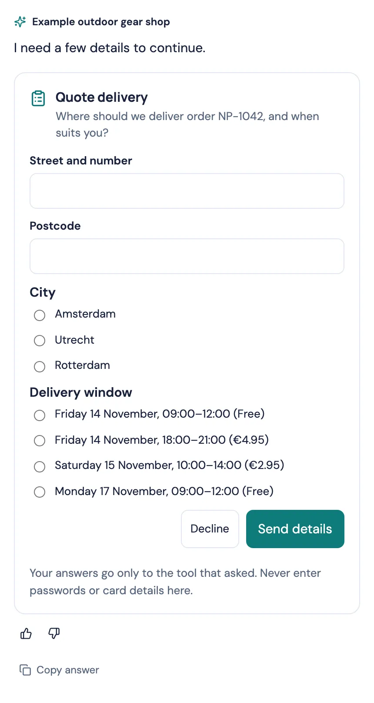
