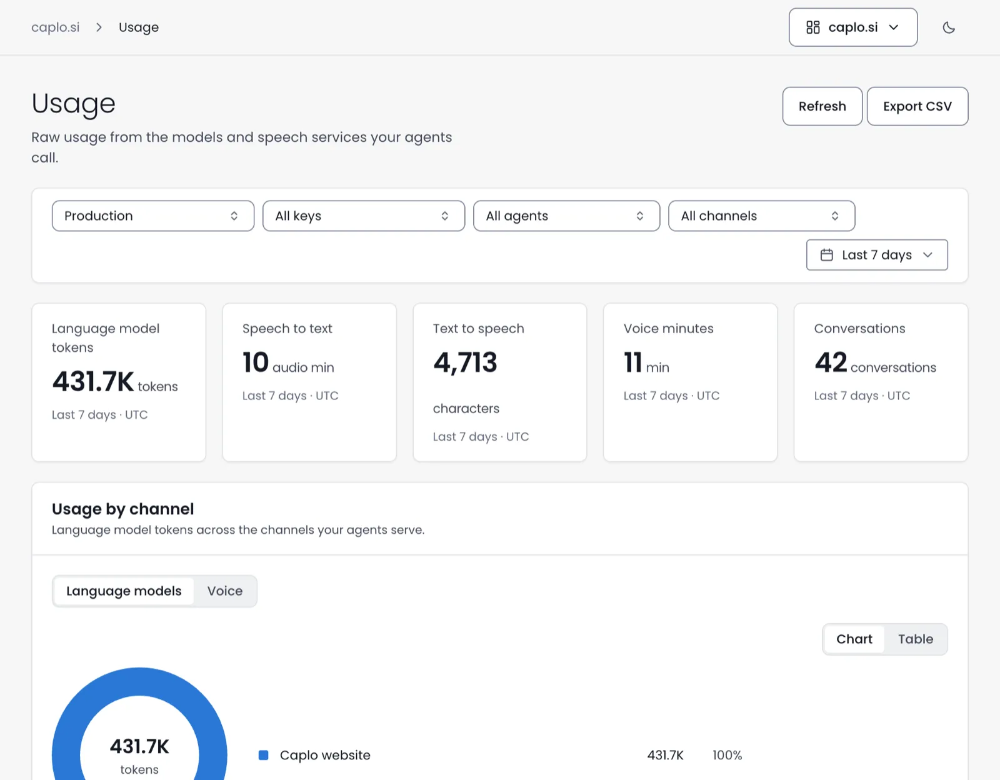
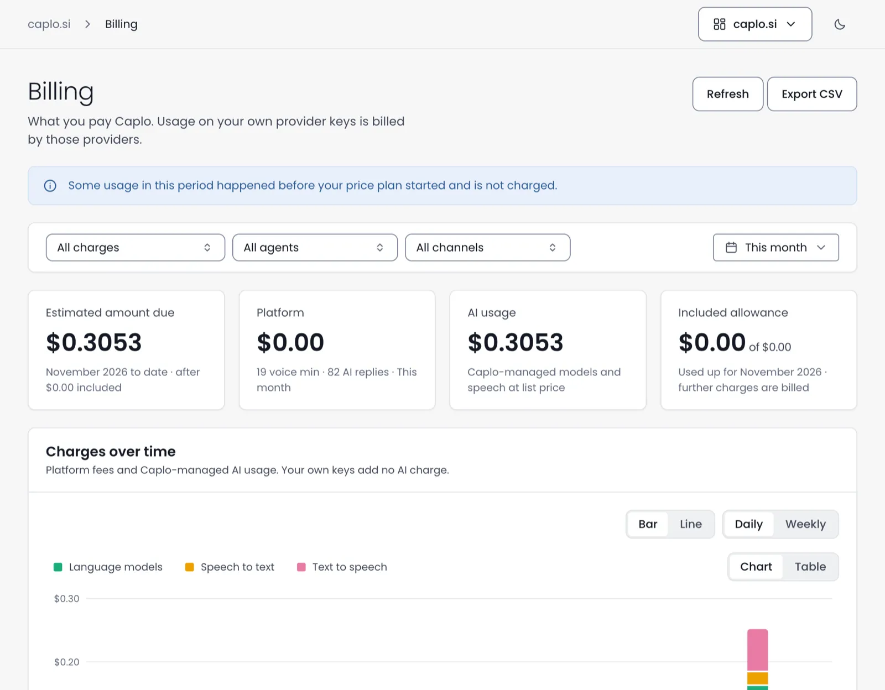

# Usage and statements

> Read the Usage and Billing pages, follow daily charges, check the month's estimated amount due, and export the data as CSV.

Two console pages, both under **Usage & billing**, show what your agents use and what you are charged:

* **Usage**: raw quantities from the models and speech services your agents call, with no prices.
* **Billing**: what you pay Caplo, by day, with the month’s statement.

Both need a role that can view financial data: Owner, Admin, Billing or Auditor. Days and months are UTC.

## Usage page

The **Usage** page answers “how much did our agents use, and where?”.

**Filters** at the top apply to everything on the page:

| Filter                    | Options                                                                                                    |
| ------------------------- | ---------------------------------------------------------------------------------------------------------- |
| **Source**                | **Production** (the default), **Live tests**, **Evals**, **Background**, **Authoring** or **All sources**. |
| **Keys**                  | **All keys**, **Caplo-managed** or **Your keys**.                                                          |
| **Agent** and **Channel** | One agent or channel, or all.                                                                              |
| Dates                     | Last 7 or 30 days, or any range within the last 400 days.                                                  |

**Tiles** show the totals for the range: **Language model tokens**, **Speech to text** (audio minutes), **Text to speech** (characters), **Voice minutes** and **Conversations**. Voice minutes and conversations are not paid with a provider key, so they show no value when you filter by keys.

**Usage by channel** shows how language model tokens or voice minutes split across your channels.

**Language models** charts tokens over time and lists them by **Model**, **Provider**, **Agent** or **Channel**, with **Input**, **Cached input**, **Output**, **Audio** (realtime models) and **Requests** columns.

**Voice** charts **Speech to text**, **Text to speech** or **Voice minutes**, grouped the same way.

Usage on your own keys is included on this page. Those providers bill you, not Caplo.

If a provider has not reported full usage for some requests yet, a note under the table says how many; their known quantities are included. Quantities update as providers report them, and each request counts once at its latest report.

## Billing page

The **Billing** page answers “what will Caplo charge us?”.

**Filters**: **Charges** (**All charges**, **Voice**, **Text** or **Language models**), **Agent**, **Channel** and **Billing dates** (**This month**, **Last month**, **Last 30 days** or a custom range).

**Tiles**:

| Tile                     | What it shows                                                                                                                                                                                 |
| ------------------------ | --------------------------------------------------------------------------------------------------------------------------------------------------------------------------------------------- |
| **Estimated amount due** | The statement for the month that contains the end of your date range: that month’s charges to date, after the included allowance. It always covers the whole workspace, whatever the filters. |
| **Platform**             | Platform fees in the range, with the number of voice minutes and AI replies.                                                                                                                  |
| **AI usage**             | Caplo-managed models and speech, at list price plus your plan’s markup.                                                                                                                       |
| **Included allowance**   | How much of the month’s allowance is used, and how much is left.                                                                                                                              |

**Charges over time** shows daily or weekly charges by type. **Charges by** splits them by channel, agent or charge type. **Charge breakdown** lists every charge in the range grouped by **Charge**, **Model**, **Provider**, **Agent** or **Channel**, with quantity, rate, amount and share.

Notes under the breakdown explain two cases:

* How many requests used your own keys. Only the platform fee for those conversations appears.
* Caplo-managed requests that used a meter without a list price yet. They are charged for their priced part only.

### Daily charges and the monthly statement

Each charge belongs to the UTC day the usage happened and is priced with the price plan in effect at that time. The monthly statement adds up the calendar month’s charges and subtracts the allowance. It is an estimate until the month closes.

To follow a month as it goes, choose **This month**. To review a finished month, choose **Last month**. **Settings** then **Billing & limits** shows the same month-to-date summary: **Estimated amount due**, **Charges to date** and **Included each month**.

## Export

Both pages have **Export CSV**:

* **Usage** exports exact quantities per UTC day, service, provider and model, with request counts and any usage Caplo cannot classify yet.
* **Billing** exports every charge per UTC day, with its charge type, provider, model, agent, channel, quantity, unit, amount in USD and whether a price plan rated it.

## Consistent numbers

Each page reads all its charts and tables from one snapshot, shown at the bottom of the page with its time. Select **Refresh** to load a newer one. Exports use the same snapshot as the page, so a CSV matches what you see.

## Related

* [How Caplo charges](/usage/)
* [Spend budgets](/usage/spend-budgets/)
* [Cost reports](/usage/cost-reports/)
